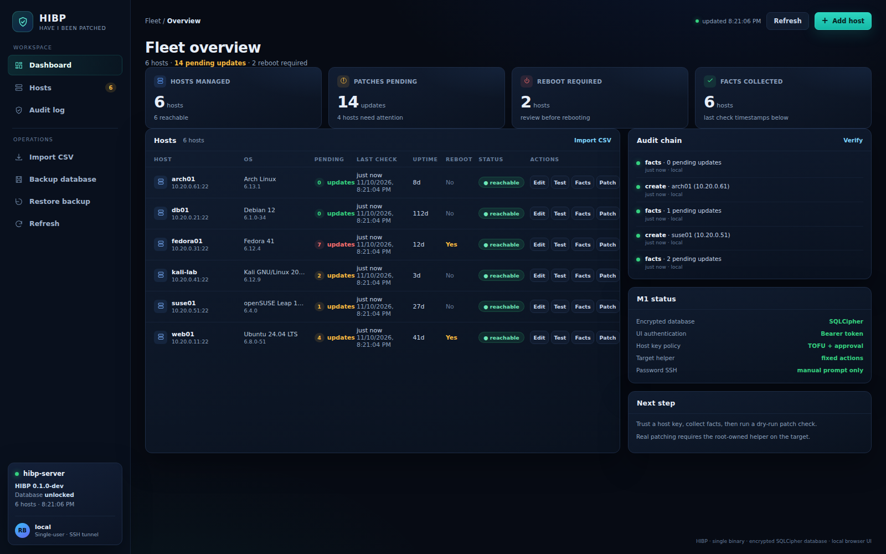
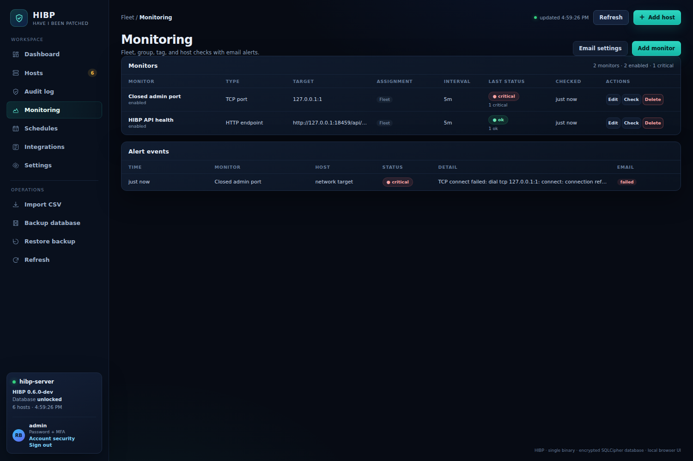
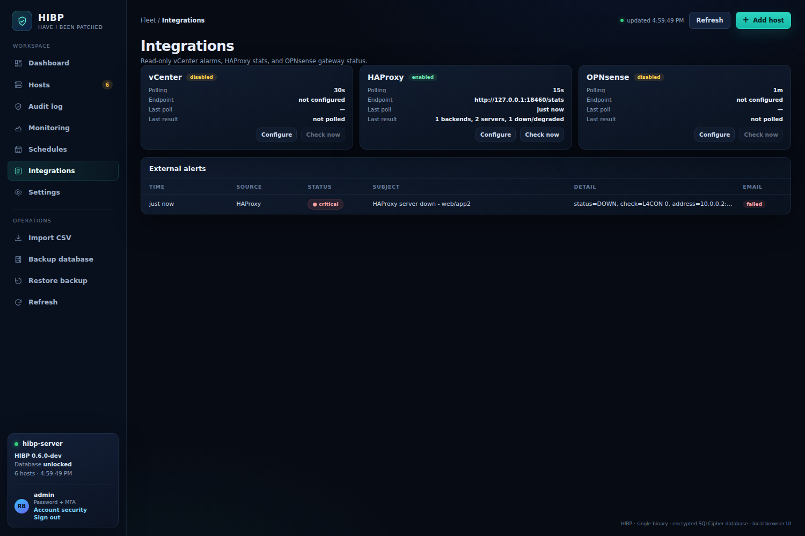
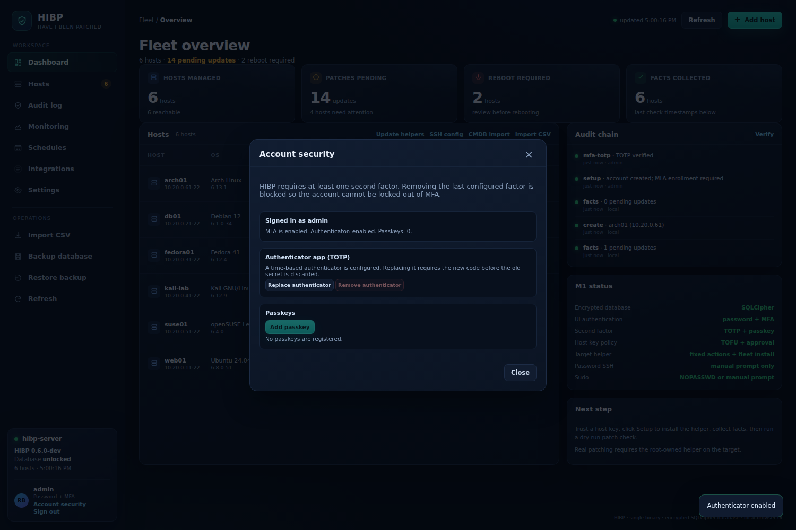
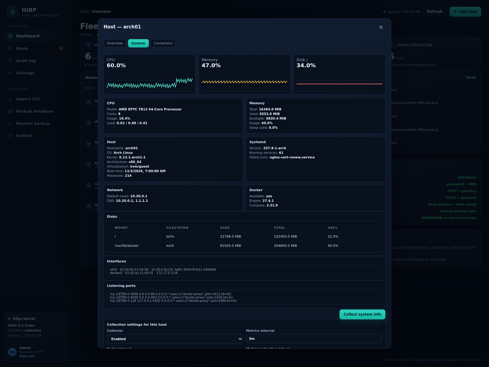
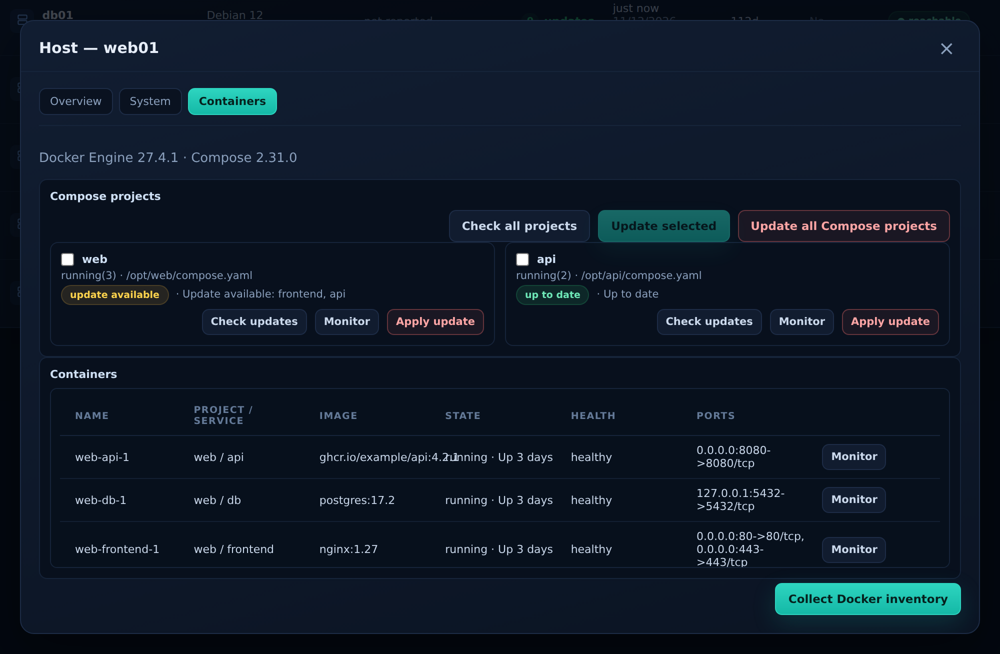
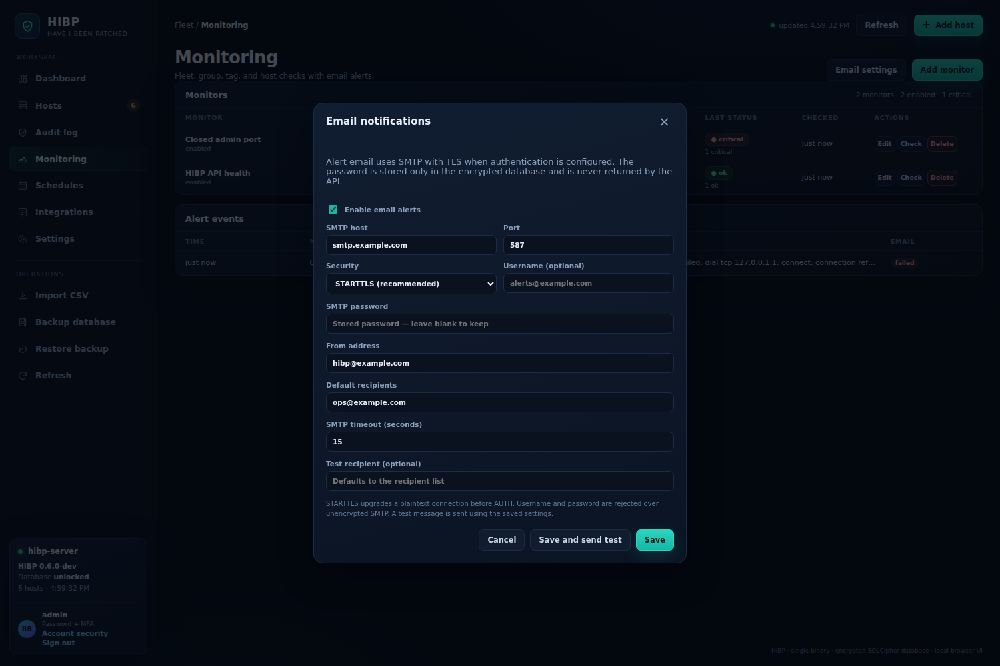
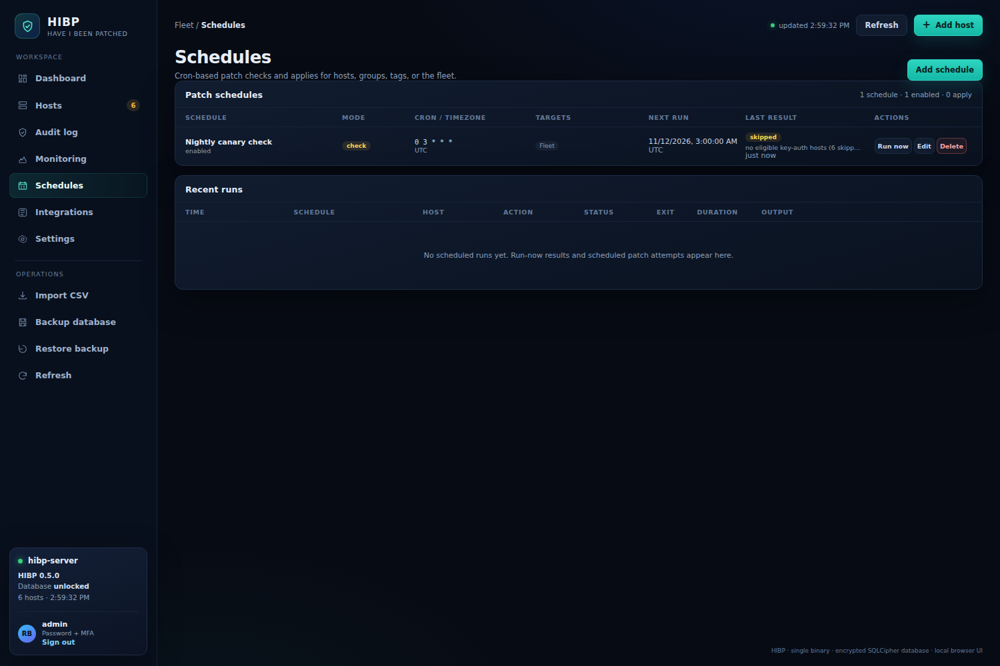
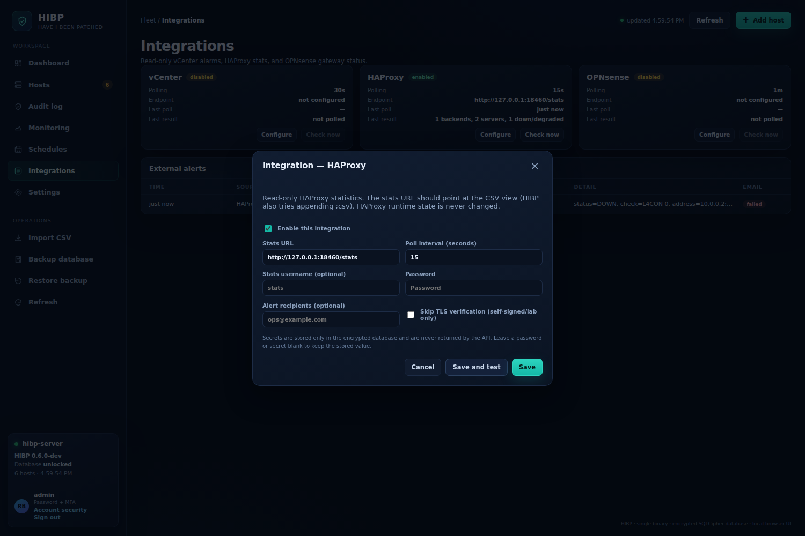
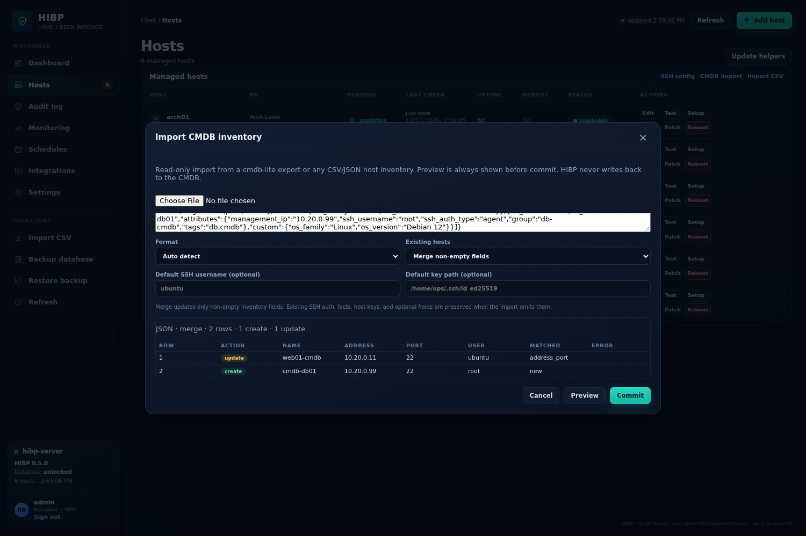

# HIBP - Have I Been Patched

> **Status: v0.6.2 production-hardening feature set with a production build path.**
> The repository contains a working Go server, browser UI, SQLCipher storage,
> host CRUD/import, password + TOTP/passkey authentication with post-enrollment
> MFA management, SSH host-key approval, remote helper installation, fact
> collection, read-only system information, Docker inventory, metric history,
> monitoring, SMTP email alerts, vCenter/HAProxy/OPNsense integrations, CMDB
> import, cron-based patch schedules with per-host retries and run history,
> reboot control, SSH config import, audit chain, backup/restore with
> configurable retention, audit-chain verification, per-host helper build
> reporting, selected-host helper updates, build identity, and automatic
> pre-migration backups, helper actions, tests, and CI. `make production`
> builds against current SQLCipher 4.20 in an Alpine/musl image; the development
> build still uses the 2020 spike driver and prints a warning. SSH password and
> sudo fallbacks are manual-run only.
>
> **Not yet production-complete:** package-level run diffs, approval workflows,
> a durable job queue with resume across restarts, approved playbooks, agent
> mode, and RBAC are not implemented. The scheduler is a single-process cron
> engine with bounded per-host retries. Read
> [Production deployment checklist](#production-deployment-checklist) and
> [Known limitations before production](#known-limitations-before-production)
> before exposing this to real hosts.
>
> **Name:** HIBP stands for **Have I Been Patched**. It is not affiliated with
> Have I Been Pwned (haveibeenpwned.com).

HIBP is a Linux-first patch management controller. The intended deployment is an
always-on server that owns the encrypted database and performs collection,
monitoring, scheduled checks/applies, and explicit patch operations. The
operator uses a laptop browser through an SSH tunnel. The current release
inventories hosts, checks for pending updates using each distribution's native
package manager, applies updates on demand or through cron schedules, and
records audit events and per-host run history. It does not yet provide a
durable job queue, approvals, or package-level diff evidence.

## Screenshots

> Screenshots of the current build running with demo data. The browser UI,
> encrypted database, host list, facts, monitoring state, and audit chain are
> real. Real patch execution requires the root-owned helper and SSH access to
> targets.







Monitoring checks use collected host snapshots and read-only network probes.
External integrations poll vCenter, HAProxy, and OPNsense without changing
them. Alert history is recorded even when email delivery is disabled or fails.

## Contents

- [Screenshots](#screenshots)
- [Install a release](#install-a-release-recommended)
- [Install prerequisites](#install-prerequisites)
- [Quick start (source build)](#quick-start-source-build)
- [Command-line reference](#command-line-reference)
- [100-host go-live gate](#100-host-go-live-gate)
- [Production deployment checklist](#production-deployment-checklist)
- [Authentication and MFA](#authentication-and-mfa)
- [Docker, system information, and monitoring](#docker-system-information-and-monitoring)
- [Target sudo setup](#target-sudo-setup)
- [What HIBP is](#what-hibp-is)
- [Why it exists](#why-it-exists)
- [Goals](#goals)
- [Non-goals](#non-goals)
- [Product requirements](#product-requirements)
- [Supported distributions](#supported-distributions)
- [Recommended architecture](#recommended-architecture)
- [Security model](#security-model)
- [Data model](#data-model)
- [Scheduling and job semantics](#scheduling-and-job-semantics)
- [Import formats](#import-formats)
- [Backup, restore, and schema upgrades](#backup-restore-and-schema-upgrades)
- [Build system and dependencies](#build-system-and-dependencies)
- [Repository layout](#repository-layout)
- [Roadmap](#roadmap)
- [Relationship to cmdb-lite](#relationship-to-cmdb-lite)
- [Confirmed decisions](#confirmed-decisions)
- [Ideas worth adding](#ideas-worth-adding)
- [Deferred decisions](#deferred-decisions)
- [Known limitations before production](#known-limitations-before-production)
- [Validation](#validation)
- [License](#license)

## What HIBP is

HIBP is the answer to three operational questions:

1. Which Linux hosts exist, and which of them need patches?
2. What exactly changed on each host, when, and with what result?
3. Can I patch one host, a group, or the whole fleet now, or on a schedule,
   without logging into every machine by hand?

The product is deliberately narrower than a configuration management system. It
does not try to be Ansible, Puppet, Chef, or Salt. It focuses on package
updates, reboot state, evidence, and the safe execution of those updates across
different Linux distributions.

## Install a release (recommended)

End users should not need Go or a compiler.

1. Download the latest release from
   <https://github.com/RogerBergling/HIBP/releases/latest>.
2. Or run the installer (inspect it first):

   ```bash
   curl -fsSL https://raw.githubusercontent.com/RogerBergling/HIBP/main/scripts/install.sh -o install.sh
   less install.sh
   sh install.sh
   ```

   The installer downloads the release archive, verifies it against the
   published `SHA256SUMS`, and installs `hibp` into `~/.local/bin` by default.

   ```bash
   # Install a specific version
   sh install.sh --version v0.6.2

   # Install system-wide (run as a user with write access to /usr/local/bin)
   sudo HIBP_PREFIX=/usr/local/bin sh install.sh

   # Then
   hibp version
   hibp server --db "$HOME/.local/share/hibp/hibp.db" --create
   ```

   Open <http://localhost:8443/> and create the admin account plus MFA.
   `hibp version` prints the semantic version, build number, commit, UTC build
   date, target, build type, and SQLCipher driver.

   Release artifacts are built with the production SQLCipher driver. The
   release automation currently publishes **linux-amd64**; build from source or
   use Docker for other architectures.

   For an offline/LAN-only controller, download the archive and `SHA256SUMS`
   on another machine, transfer them, verify with `sha256sum -c`, and install
   the binary manually. The runtime does not need internet access.

3. Docker option (the image is published as `ghcr.io/rogerbergling/hibp`):

   ```bash
   docker pull ghcr.io/rogerbergling/hibp:latest
   mkdir -p /var/lib/hibp
   chown 65532:65532 /var/lib/hibp
   docker run --rm -it --network host \
     -v /var/lib/hibp:/var/lib/hibp \
     ghcr.io/rogerbergling/hibp:latest \
     server --db /var/lib/hibp/hibp.db --create --listen 127.0.0.1:8443
   ```

   The container runs as UID/GID `65532`. If you need SSH keys, mount a
   controller-owned key directory read-only and pass `--key-dir` and
   `--ssh-config`; the scratch image has no home-directory key defaults. Mounted
   key and passphrase files must be readable by UID 65532. Do not place the
   database on a network filesystem.

You do **not** need the prerequisites below unless you are building from source.

## Install prerequisites

These prerequisites are only needed when you build HIBP from source.

HIBP's development build needs **Go 1.27 or newer** and a **C compiler** because
the SQLCipher driver uses CGO. Use the latest Go 1.27 patch release; CI runs
`govulncheck` as a release gate. A local older patch may report standard-library
issues that are already fixed upstream. The production build uses **Docker** and
builds Go, SQLCipher, and OpenSSL inside the image.

If you want the repository to install Go locally for you, run:

```bash
sh scripts/setup-dev.sh
# or
make bootstrap
```

The script uses Go from `PATH` when available; otherwise it downloads Go into
`$HOME/.local` and builds. It does not use sudo.

You do **not** need Go or a compiler on managed targets. Targets only need an
SSH server and their native package manager; the controller runs the helper
binary there.

### Ubuntu, Debian, and Kali

```bash
sudo apt update
sudo apt install -y build-essential make pkg-config ca-certificates curl tar

# Install Go 1.27 from upstream. The distribution package may be older.
GO_VERSION=1.27.3
curl -fsSLO "https://go.dev/dl/go${GO_VERSION}.linux-amd64.tar.gz"
sudo rm -rf /usr/local/go
sudo tar -C /usr/local -xzf "go${GO_VERSION}.linux-amd64.tar.gz"
rm "go${GO_VERSION}.linux-amd64.tar.gz"

# Add Go to PATH for the current shell and future login shells.
export PATH="$PATH:/usr/local/go/bin"
echo 'export PATH="$PATH:/usr/local/go/bin"' >> "$HOME/.profile"

go version
gcc --version
```

For ARM64, replace `linux-amd64` with `linux-arm64` in the download name.

If you do not have sudo, install Go under your home directory instead:

```bash
mkdir -p "$HOME/.local"
curl -fsSL "https://go.dev/dl/go1.27.3.linux-amd64.tar.gz" \
  | tar -xz -C "$HOME/.local"
export PATH="$HOME/.local/go/bin:$PATH"
```

Then run `make build` normally, or pass the binary path explicitly:

```bash
make build GO="$HOME/.local/go/bin/go"
```

### Fedora, RHEL, Rocky Linux, and AlmaLinux

```bash
sudo dnf install -y gcc make pkgconf-pkg-config curl tar ca-certificates

GO_VERSION=1.27.3
curl -fsSLO "https://go.dev/dl/go${GO_VERSION}.linux-amd64.tar.gz"
sudo rm -rf /usr/local/go
sudo tar -C /usr/local -xzf "go${GO_VERSION}.linux-amd64.tar.gz"
rm "go${GO_VERSION}.linux-amd64.tar.gz"
export PATH="$PATH:/usr/local/go/bin"
echo 'export PATH="$PATH:/usr/local/go/bin"' >> "$HOME/.bashrc"
```

### openSUSE and SLES

```bash
sudo zypper install -y gcc make pkg-config curl tar ca-certificates

GO_VERSION=1.27.3
curl -fsSLO "https://go.dev/dl/go${GO_VERSION}.linux-amd64.tar.gz"
sudo rm -rf /usr/local/go
sudo tar -C /usr/local -xzf "go${GO_VERSION}.linux-amd64.tar.gz"
rm "go${GO_VERSION}.linux-amd64.tar.gz"
export PATH="$PATH:/usr/local/go/bin"
```

### Arch Linux

```bash
sudo pacman -S --needed go gcc make pkgconf curl tar
go version
```

### Alpine Linux (build environment only)

```bash
sudo apk add go gcc musl-dev make pkgconf curl tar
go version
```

Alpine's packaged Go may lag behind 1.27. If `go version` is older than 1.27,
use the official tarball for musl or build in the Docker image.

### Docker for the production build

The production build does not use your local Go installation. It needs Docker:

```bash
# Ubuntu / Debian
sudo apt install -y docker.io
sudo usermod -aG docker "$USER"
# Log out and back in so the group change applies.
docker version
```

For other distributions, use the official Docker installation instructions:
<https://docs.docker.com/engine/install/>.

### Optional: use the distribution's SQLCipher instead of Docker

If you do not want Docker but want the production driver instead of the legacy
development driver, install the SQLCipher development files and run:

```bash
# Fedora / RHEL family
sudo dnf install -y sqlcipher-devel

# Debian / Ubuntu
sudo apt install -y libsqlcipher-dev

# openSUSE / SLES
sudo zypper install -y sqlcipher-devel

make build-system
```

`make build-system` links against the distribution's SQLCipher and uses the
patched `mattn/go-sqlite3` driver. The resulting binary is dynamically linked;
release artifacts still use the static Docker build.

### Verify the toolchain

```bash
go version       # must report go1.27 or newer
gcc --version    # must be available
make --version
```

### Troubleshooting

**`go: command not found`**

The easiest source-build fix is:

```bash
make bootstrap
```

It downloads Go into `$HOME/.local` if needed and runs the build. Or install Go
from the tarball and add it to `PATH`:

```bash
export PATH="$PATH:/usr/local/go/bin"
command -v go
go version
```

For a permanent shell fix, add that export to `~/.profile` or `~/.bashrc`.
You can also pass the path directly:

```bash
make build GO=/usr/local/go/bin/go
```

**`gcc: command not found`**

Install the C toolchain:

```bash
# Ubuntu / Debian / Kali
sudo apt install -y build-essential
# Fedora / RHEL family
sudo dnf install -y gcc make
# openSUSE / SLES
sudo zypper install -y gcc make
# Arch
sudo pacman -S --needed gcc make
```

**`CGO_ENABLED=0` errors**

HIBP requires CGO for SQLCipher. Do not set `CGO_ENABLED=0`; the Makefile sets
`CGO_ENABLED=1` for the development build.

**`docker: command not found` when running `make production`**

Install Docker or use the development build:

```bash
make build
```

**Permission errors in `/usr/local`**

Do not run `sudo make build`. Install Go and the compiler with sudo, then build
as your normal user. If you cannot install Go system-wide, use the home-directory
method above.

### Optional tools

- `python3` 3.9+ for the README validator and its tests.
- `git` for cloning the repository.
- `sqlite3` is not required by HIBP; the database is SQLCipher.

## Quick start (source build)

For a prebuilt binary, use [Install a release](#install-a-release-recommended) instead.

```bash
# Install the prerequisites above first.
make build

# Create the encrypted database and start the local UI
./dist/hibp server --db ~/.local/share/hibp/hibp.db --create

# Open http://localhost:8443/ (the server prints the exact URL)
```

On first visit, create the administrator account, then enroll TOTP and/or a
passkey. After that, add a host, click **Test** to approve its host key, then
click **Setup** to install the restricted helper on the target.

Use **localhost**, not **127.0.0.1**, if you want passkeys. WebAuthn relying
party IDs must be hostnames; IP addresses are rejected. TOTP works with either.

The server browses `~/.ssh` in the host form by default. Add more key
directories with a comma-separated flag:

```bash
./dist/hibp server --db ~/.local/share/hibp/hibp.db \
  --key-dir "$HOME/.ssh,/etc/hibp/ssh"
```

The **SSH config** button reads the local `~/.ssh/config` and prefills a host
form from a concrete alias. It follows simple `Include` files, skips wildcard
and `Match` blocks, and never returns private key contents. Override the config
path with `--ssh-config /path/to/config`.

Requires Go 1.27+, a C toolchain, and CGO for the development build. The
passphrase must be at least 12 characters. Use `make static` for the development
static ELF, or `make production` for the current-SQLCipher Docker build. The
target helper installation and sudoers example are in
[`packaging/README.md`](packaging/README.md).

## Command-line reference

The same binary provides the server, target helper, account recovery, and
version commands.

```text
hibp server [flags]
hibp helper <action> [args]
hibp user reset --username <name> [--db <path>] [--passphrase-file <path>]
hibp version
```

Server flags:

| Flag | Default | Notes |
| --- | --- | --- |
| `-db` | `$XDG_DATA_HOME/hibp/hibp.db` or `~/.local/share/hibp/hibp.db` | Database file. The `.meta` sidecar is created next to it. |
| `-listen` | `127.0.0.1:8443` | Only `127.0.0.1:<port>` or `localhost:<port>` is accepted. |
| `-create` | off | One-time database creation. Fails if the database or sidecar already exists. |
| `-passphrase-file` | prompt | Must be group/world-inaccessible. Omit it to prompt on the terminal. |
| `-key-dir` | `~/.ssh` | Comma-separated SSH key browser roots. The API can still reference any absolute path the service account can read. |
| `-ssh-config` | `~/.ssh/config` | Local OpenSSH config used only to prefill host forms. |
| `-demo` | off | Seeds sample hosts when empty. Use only for screenshots or demos. |
| `-version` | off | Prints the version, build number, commit, build date, target, build type, and SQLCipher driver, then exits. |

Helper actions are intentionally fixed: `facts`, `check`, `apply`, `reboot`,
`reboot-check`, `system-info`, `metrics`, `docker-list`, `docker-check <project>`,
and `docker-apply <project>`. The helper does not accept package names, host
names, or shell fragments.

Important constraints:

- The server requires the database passphrase before it starts. There is no
  locked/paused browser UI in v0.6.2. If the process stops, the UI, collector,
  scheduler, and monitoring stop with it.
- `-create` is not an upgrade or reset flag. It refuses an existing database.
- `-demo` writes sample hosts and is not a production mode.
- `hibp user reset` clears the account password, TOTP, passkeys, and all
  sessions. Stop the server before running it, and expect MFA enrollment again
  on the next login. Use `--passphrase-file` when the server is configured for
  headless unlock.
- `hibp helper` is normally invoked through the fixed sudoers rule on a target;
  running it directly is useful only for diagnosis.

The HTTP `/api/v1` endpoints are the browser UI's private interface. They are
authenticated, but they are not documented as a stable public API and have no
compatibility guarantee between releases. Do not build unattended integrations
against them without pinning and testing a release.

### Version and build information

`hibp version` and `hibp server --version` print the complete build identity:

```text
hibp 0.6.2
build:  1234
commit: abc123def456
date:   2026-11-11T12:00:00Z
target: linux/amd64
type:   release
sqlcipher driver: ...
```

The browser UI shows the controller version in the lower-left server card, with
the build number and commit beneath it. Hover the label to see the full identity.
The Hosts table also has an **Agent** column for the build reported by the
installed helper on each target. An amber version means the helper build differs
from the running controller; **not reported** means facts have not been collected
since the helper was updated.

Build metadata is generated by `make`:

- **version**: `git describe --tags --always --dirty`; release builds pass the
  tag without the leading `v`;
- **build number**: `GITHUB_RUN_NUMBER` in CI, otherwise the local commit count;
- **commit**: the first 12 characters of `GITHUB_SHA`, otherwise short `HEAD`;
- **date**: UTC build time;
- **target**: `GOOS/GOARCH`;
- **type**: `development`, `release`, or the CI override.

Override the inferred values for a controlled build:

```bash
make build VERSION=0.6.2 BUILD_NUMBER=1234 BUILD_COMMIT=abc123def456
```

`make production` passes the same values as Docker build arguments and records
the build type as `release`. The release workflow supplies the Git tag, GitHub
run number, commit, date, and `linux/amd64` explicitly.

## 100-host go-live gate

This is the short gate for the intended deployment: one controller, roughly 100
Fedora/Ubuntu/Kali x86_64 targets, SSH-tunnel-only UI access, LAN-only runtime,
and no internet egress. It complements, and does not replace, the detailed
checklist and limitations below.

### Confirmed deployment profile

The decisions below are the working profile for this rollout:

- **Controller:** one dedicated **Fedora x86_64 or Ubuntu x86_64** controller.
  Do not run two controller processes against the same database.
- **Targets:** Fedora, Ubuntu, and Kali on x86_64. **Alpine is out of scope for
  this rollout.**
- **Network:** all targets are directly reachable from the controller over SSH.
  No jump host, bastion, NAT traversal, or HTTP proxy is required.
- **Patching policy:** apt `upgrade` semantics are accepted. Held-back packages
  are tracked separately and are not forced by HIBP.
- **Unlock:** use the packaged systemd service with a `0400` passphrase file on
  a full-disk-encrypted controller so schedules and collection recover after a
  reboot. Keep `scripts/start-interactive.sh` for first-run setup, recovery, and
  situations where you deliberately want interactive unlock. The passphrase
  file is a real secret; protect the controller as a root-equivalent system.
- **Backups:** set the backup directory in **Settings** and keep the latest
  **3** encrypted backups. HIBP prunes timestamped backups it created in that
  directory; arbitrary files are left alone. Keep at least one copy off the
  controller.
- **SMTP:** configure the relay by IP address and port **25** initially, with
  plain SMTP and no authentication. The UI currently prefills port `587`, so set
  `25` and mode `none` explicitly; host, port, TLS mode, and credentials remain
  configurable.
- **Audit:** local hash-chained audit only; no external sink is required for this
  rollout.

This profile still requires the canary and restore tests below.

### Confirm these facts first

- **Controller OS and version.** Ubuntu 24.04/26.04 is the CI-tested server
  baseline. Fedora is build-supported but is not in the release CI matrix.
  Record the exact controller version you will run. Choose one controller host;
  do not run two controllers against one database.
- **Architecture.** The confirmed fleet is **x86_64**, so use the published
  **linux-amd64** release. An ARM64 controller or target would require a source
  build, and the controller and target helper architecture must match. The
  installer still constructs an `arm64` asset name, but no such release asset is
  currently published.
- **Capacity.** Plan at least 2 vCPU, 4 GB RAM, and 20 GB free disk as a
  starting point; the Argon2id unlock alone uses 256 MiB. No 100-host load test
  has been run, so size the data volume from measured database growth plus
  backups. The database, WAL/SHM files, automatic pre-migration backups, and
  manual backups all live on that volume.
- **Single instance.** Only one HIBP process may open the database. Do not run
  the systemd unit and a tmux/screen session against the same database.
- **Network.** The confirmed topology is direct SSH from the controller to every
  target. The controller also needs SMTP to the relay and, if enabled, HTTP/HTTPS
  to LAN integrations and monitored endpoints. It does not need internet access
  at runtime. Inbound access should be SSH from the administrator only; the UI
  stays on loopback. There is no jump-host, bastion, SSH proxy, or HTTP proxy
  support in this release.
- **Time.** Run NTP/chrony on the controller and every target. Scheduler
  decisions and TOTP depend on the controller clock. Target time sync is
  reported as a fact but is not enforced before apply.
- **Final passphrase.** Decide the database passphrase before creating the
  production database. There is no passphrase-rotation/rekey workflow; changing
  it means rebuilding or restoring with the new key.

### Target readiness

- Use an OpenSSH-compatible SSH server with key-file authentication. Keys must
  be unencrypted and mode `0600`; `ssh-agent`, hardware-backed keys, SSH
  certificates, and passphrase-protected keys are not supported.
- Install the root-owned helper and the restricted `NOPASSWD` sudoers rule on
  every target you intend to schedule. Test `sudo -n` as the SSH account. The
  helper binary architecture must match the target; the UI bootstrap checks
  `uname -m` and refuses a mismatch. Password-based SSH and sudo are manual-run
  fallbacks only and are never used by the scheduler.
- Verify each host fingerprint through an independent channel. The first
  connection is trust-on-first-use; a changed key requires an explicit new
  approval. Re-check the presented fingerprint before clicking **Trust**.
- **Fedora:** install `dnf-plugins-core` (or the package that provides
  `needs-restarting`) if you want reboot-required detection. Without it the
  helper can report "no reboot required" even when one is needed.
- **Debian/Ubuntu/Kali:** the current apply path uses
  `apt-get ... upgrade`, not `full-upgrade`. This is accepted for this rollout.
  Packages held back because they need dependency changes, removals, or a
  distribution upgrade remain installed and must be reviewed separately. Kali
  is rolling; track held-back packages explicitly.
- **Alpine is out of scope for this rollout.** If it is added later, install
  `sudo` (which provides `visudo`). Alpine has no systemd, so service-state
  monitoring and `timedatectl`-based time-sync reporting are unavailable. Reboot
  detection is heuristic and may not detect kernel changes because Alpine
  commonly uses `/lib/modules` while the current check looks under
  `/usr/lib/modules`. Validate helper installation and reboot detection manually
  on an Alpine canary before adding it.
- Ensure each target has working package repositories, DNS, free space on
  `/boot`, `/var`, and the package-manager filesystem, no stale package-manager
  lock, and a tested reboot policy.
- The current apply path does **not** gate on free disk space, time sync,
  repository reachability, EOL status, or package-manager locks. The package
  manager reports its own failure; HIBP does not preflight those conditions or
  cancel a run at the end of the maintenance window.

### Patching and schedule policy

- Start with one Fedora host, one Ubuntu host, and one Kali host if present.
  Run a **check-only** schedule, inspect **Recent runs**, then apply a small real
  update and verify the host.
- Use low schedule concurrency first (2–3), not the maximum 20. The scheduler
  has a controller-wide cap of 20 concurrent host operations; the collector can
  add up to 4 more SSH sessions, and manual operations are not included in that
  cap.
- Schedule apply jobs with a window longer than the expected run. A single host
  has a 45-minute apply timeout; 100 hosts at 20-way concurrency can take several
  hours in the worst case. HIBP does not stop or cancel work at the window end.
- Reboots are never automatic. Plan a separate reboot/verify step, especially
  for kernel updates. The `reboot-check` result and the host uptime are
  evidence, not an enforcement mechanism.
- There is no package-level old/new diff. If you need per-package evidence,
  capture the bounded run output or use distribution-side history until a
  package diff is implemented.
- A failed or interrupted apply can leave a target partially updated. HIBP does
  not provide package-transaction rollback. Use VM snapshots, distribution
  rollback tooling, or a tested recovery plan for high-risk hosts.
- Decide what happens when a run fails: the current retry count is per host and
  bounded; retries use a short backoff, including for authentication and policy
  failures. Do not rely on retries as a substitute for fixing a broken host.

### Backups and recovery

- Set **Settings → Backup directory** and **Backups to keep**. The initial
  target is **3**. HIBP prunes timestamped backups it created in the destination
  directory; files with other names are not touched. Keep at least one off the
  controller; a same-directory backup is convenience, not disaster recovery.
- Test a real restore to a new path, open it with the matching binary and
  passphrase, and verify hosts and the audit chain. Keep the matching release
  binary with the backup.
- HIBP does not prune arbitrary files, and SQLite WAL files also consume disk.
  Budget for the configured backup count and any custom-named copies.
- Record the database path, sidecar path, passphrase storage location, service
  account, and restore procedure in your runbook. Do not store the passphrase in
  the same backup.
- Back up before the first production use and before every upgrade. The
  automatic pre-migration backup is a safety net, not a substitute for an
  off-host copy.

### Observability and security sign-off

- Keep the UI loopback-only and use an SSH tunnel with
  `-o ExitOnForwardFailure=yes`. Do not expose port 8443 to the LAN.
- Protect the controller with full-disk encryption, a dedicated service
  account, restricted sudo, and a firewall that permits only the required
  outbound flows and administrator SSH.
- Keep controller logs in journald or another persistent sink. HIBP writes
  operational logs to stderr and does not provide log rotation. `/healthz` is a
  liveness response and does not prove the database, scheduler, or SMTP relay is
  healthy.
- Configure SMTP initially with the relay **IP address** and port **25**, plain
  SMTP, no authentication. Host, port, TLS mode, and credentials remain
  configurable in the UI. Test with a real message. A plaintext,
  unauthenticated Postfix relay is acceptable only on a trusted LAN and must be
  restricted to the controller.
- Enroll a second MFA factor and document local `hibp user reset` recovery. There
  is no password-change UI, session-list/revoke UI, RBAC, or remote recovery.
- Verify release checksums before installation. Releases are not signed and
  have no SBOM or provenance attestation; protect the transfer path and keep the
  artifact with its checksum.
- Complete the canary, restore, host-key rotation, helper reinstall, failed-run,
  and controller-restart tests before enabling a fleet-wide apply schedule.

## Production deployment checklist

This is the minimum operational and security review before using HIBP against
real hosts. It reflects the current v0.6.2 implementation; treat it as a
gate, not as a suggestion.

### 1. Confirm the deployment model

- Use a dedicated Linux controller with a dedicated, unprivileged service
  account. Ubuntu 24.04/26.04 is the CI-tested baseline; Fedora is
  build-supported but not covered by the release CI matrix. Test the exact
  controller OS you deploy.
- Keep the browser UI on loopback and reach it through an SSH tunnel. The
  current code does not terminate TLS and has no supported reverse-proxy mode.
  Do not publish port 8443 or the Unix-equivalent API to a network.
- HIBP is single-operator in this release. There is no RBAC, approval workflow,
  or separation between an operator and an auditor.
- The current release implements cron-based check/apply schedules, bounded
  per-host retries, per-host operation locks, per-host run history, and manual
  run-now. It does not implement a durable job queue, package-level diffs,
  approvals, resume across a controller restart, host disable/maintenance
  state, or approved playbooks. Review the scheduler limitations before making
  it authoritative.

### 2. Create the service account and protected paths

```bash
sudo useradd --system --home /var/lib/hibp --shell /usr/sbin/nologin hibp
sudo install -d -o hibp -g hibp -m 0700 /var/lib/hibp
sudo install -d -o root -g hibp -m 0750 /etc/hibp
sudo install -d -o hibp -g hibp -m 0700 /etc/hibp/ssh
```

- Put SSH keys in a directory owned by the HIBP service account, with key files
  at mode `0600`. The packaged systemd unit sets `ProtectHome=true`, so keys
  under `/home/hibp/.ssh` are not readable. Use `--key-dir /etc/hibp/ssh` and
  `--ssh-config /etc/hibp/ssh/config`, or adjust the unit deliberately.
- Keep the database, sidecar, backups, and passphrase file off network
  filesystems. File locking and SQLCipher consistency assume local storage.
- If the service unit uses `ProtectSystem=strict`, only paths listed in
  `ReadWritePaths` are writable. Put backups under `/var/lib/hibp` or add an
  explicit writable backup directory to the unit. The web UI accepts arbitrary
  absolute paths, but the unit may still deny them.

### 3. Network and firewall

- Keep the UI on controller loopback. Do not expose TCP `8443` to the LAN or
  internet. Administrator access is SSH to the controller plus a local tunnel.
- Controller outbound: SSH (`22/tcp` or your target port) to managed hosts,
  SMTP to the relay, and optional HTTP/HTTPS to LAN integrations/monitored
  endpoints. No internet access is required at runtime.
- Controller inbound: SSH from the administrator network only. If the
  controller is a VM, apply the same rules in the hypervisor/security group.
- Targets: allow SSH from the controller address only, and install the
  restricted helper rule. Do not open package-manager or helper ports.
- If you use Docker with `--network host`, remember that the container's
  loopback listener is the host's loopback; the firewall and local-user
  boundary still apply.
- Verify the rules from the controller (`ss -lntup`, `nc`/`ssh` checks) and
  from a non-controller host before scheduling patches.

### 4. Choose the database unlock policy

For this 100-host scheduled fleet, prefer the **headless systemd + protected
passphrase file** path below. It lets the controller recover after a reboot
without an operator and is the more reliable choice for unattended patching.
Use interactive `tmux`/`screen` unlock only for first-run setup, recovery, or if
you deliberately require no decryptable passphrase on the controller disk. Both
paths are documented; do not run both against the same database.

Interactive unlock is supported when the server has a real terminal. For a
manual-unlock deployment, keep the process in a persistent local console, a
`tmux`/`screen` session, or an equivalent supervised terminal; if the terminal
or SSH session dies, the controller and its schedules stop. The repository
includes `scripts/start-interactive.sh`, which prefers `tmux` and falls back to
`screen`:

```bash
# First run, create the database, then enter the passphrase in the session
sudo HIBP_CREATE=1 sh scripts/start-interactive.sh

# After a reboot or when the session is gone
sudo sh scripts/start-interactive.sh
```

The script starts the server as the `hibp` service user via `runuser`/`sudo`; it
does not put the passphrase in argv or the environment. Do not use it while a
systemd unit is already running against the same database. It assumes the
default `/etc/hibp/ssh` key/config paths; override `HIBP_KEY_DIR`,
`HIBP_SSH_CONFIG`, `HIBP_DB`, `HIBP_BIN`, or `HIBP_SESSION` if needed. Paths with
whitespace are not supported by this helper.

Recommended for this rollout — headless systemd with a passphrase file:

- Store the passphrase in a `0400` or `0600` file readable only by the HIBP
  service account, with full-disk encryption, and pass `--passphrase-file`.
- Accept that the service account can read the passphrase while the host is
  running. This is the availability/security trade-off; there is no TPM-sealed
  unlock in this release.
- Do not put the passphrase in the unit file, an environment variable, shell
  history, or an unencrypted backup.
- Use a long random passphrase (20+ random characters is a reasonable minimum);
  the enforced 12-character minimum is a floor, not a recommendation.
- There is no passphrase-rotation command and no envelope/DEK wrapping in this
  release. Plan to restore from a backup made with the new key, or rebuild and
  re-enroll, if the passphrase changes.
- Schedules and collection do not run until the server is unlocked and running.
  Interactive unlock is therefore an availability decision, not just a UI
  preference.

### 5. Complete first-run setup immediately

Start the controller once with `--create`, open it through the SSH tunnel, and
create the administrator plus MFA. Until the first account is created, any
local user who can reach the loopback port could claim the administrator
account. Do not leave a freshly created database unattended.

The UI supports TOTP and passkeys at enrollment. After sign-in, **Account
security** in the sidebar lets you add another passkey, replace the TOTP
authenticator, and remove a factor. HIBP refuses to remove the last remaining
factor. Register a backup authenticator during setup and test recovery with
`hibp user reset` before relying on it. That command clears TOTP, all passkeys,
and all sessions.

### 6. Validate SSH and helper rollout on a canary

- Scheduled collection runs only for hosts with `auth_type=key` and a trusted
  host key. Manual password SSH is supported, but no password is stored.
- Only `key` and `password` are accepted for `auth_type`. `ssh-agent` and SSH
  certificate authentication are rejected by host create, update, CSV import,
  and CMDB import; the current transport implements only an unencrypted key file
  or a manual password.
- Verify the host fingerprint through an independent channel before clicking
  **Trust**. Do not trust a first-use prompt blindly.
- Install the helper on one canary host first, verify the generated
  `/etc/sudoers.d/hibp-helper` with `visudo -c`, then run a dry-run patch check.
- Create a **check-only** schedule for the canary and inspect the run history
  before creating an apply schedule. Start with a small host assignment and
  low concurrency.
- The helper is a root-owned binary. Do not loosen the rule to
  `NOPASSWD: ALL`; keep the fixed action list.
- Confirm targets have working package repositories, time synchronization,
  free disk space, and a tested reboot policy. Alpine lacks systemd service
  monitoring and needs `sudo`/`visudo` installed for helper setup.

### 7. Test email and alert volume

- Use STARTTLS or implicit TLS for authenticated SMTP. Test the exact sender
  domain and recipient list with **Save and send test** before relying on alerts.
  A local Postfix relay with no authentication can be used by selecting plain
  SMTP and `127.0.0.1:25` (or the LAN address); restrict that relay to trusted
  sources. For this rollout, start with the relay IP and port `25`, then change
  host, port, TLS, or credentials in the UI if needed. The UI currently
  prefills port `587`; set `25` and mode `none` explicitly, leave
  username/password blank, and set a valid `From` address that the relay accepts.
- Configure SPF, DKIM, and DMARC for the sender domain; a valid SMTP login does
  not guarantee inbox delivery.
- Start with one host or one group. A fleet-scoped monitor can send one message
  per host and per state change; HIBP does not aggregate fleet alerts.
- Schedule summaries use the same SMTP configuration. Start with
  failure-only notifications and verify the local Postfix queue and logs.
- Alert events are recorded even when SMTP is disabled or delivery fails. Check
  the alert tables as well as the mailbox.
- There is no alert-event retention policy yet. Plan database growth and
  external log review.

### 8. Configure integrations with least privilege

- vCenter: use a dedicated read-only account that can read all managed entities
  and alarms. The poller retrieves triggered alarm state and never changes
  vCenter. Keep TLS verification enabled unless you deliberately accept a
  self-signed lab.
- HAProxy: expose only the stats CSV endpoint; do not give HIBP the admin socket
  or runtime-control credentials. Prefer a dedicated stats user.
- OPNsense: use a dedicated API key/secret with read-only gateway/status access.
- Use HTTPS for any credentialed HAProxy or OPNsense endpoint. The current URL
  validation permits `http://` for those integrations, which would expose Basic
  auth/API credentials on the network; if you must use HTTP, isolate the
  management network. vCenter is HTTPS-only.
- Integration polling originates from the controller and can reach internal
  networks. Restrict controller egress to the intended endpoints.
- The runtime does not require internet access or telemetry. It needs SSH to
  targets, SMTP to the relay, and (if enabled) HTTPS/HTTP to the LAN
  integrations and monitored endpoints. Installation/upgrades need a release
  transfer path; use a release tarball on an offline host rather than the
  GitHub installer when the controller has no internet.
- For internal-CA vCenter/OPNsense endpoints, add the CA to the controller's
  trust store (the scratch Docker image includes only the public CA bundle) or
  use the explicit TLS-verification opt-out only for a controlled lab.
- Integration poll failures are shown on the source card but are not separately
  emailed. Monitor the controller's own logs/health.
- External finding notifications are sent on new findings and severity changes;
  there is no repeat-reminder policy for integrations in this release.

### 9. Back up before use and before every upgrade

- Create a backup immediately after setup and before every application or
  schema upgrade. In **Settings**, set the backup directory and retention count
  (start with `3`). HIBP also creates an automatic, verified
  `<database>-pre-migration-YYYY-MM-DD-HHMMSS.bac` plus `.meta` backup before
  applying pending migrations. A failed backup aborts the upgrade.
- In the backup dialog, leave the path blank to use the configured backup
  directory, or enter an existing directory. HIBP creates a timestamped
  `hibp-YYYY-MM-DD-HHMMSS.bac` plus `.meta` file. A new absolute file path is
  also accepted. HIBP prunes its own timestamped backups in the destination
  directory according to the retention count; custom-named files are not
  pruned.
- Back up the database and its `.meta` sidecar together. A backup without the
  sidecar cannot be opened.
- The backup verifier opens the copy, checks that migrations exist, and
  recomputes the full audit chain. It does not offer a
  backup-without-secrets mode.
- Test a restore to a new path while the service is stopped, then open the
  restored file with the original passphrase and verify hosts and audit.
- Keep at least one encrypted backup off the controller. A same-directory
  backup does not protect against disk loss or ransomware.
- The configured retention count applies only to HIBP-created timestamped
  backups. If you copy backups off-host, apply retention there separately.
- Keep the matching release binary with every backup. HIBP hard-refuses a
  database whose recorded schema version is newer than the running binary, but
  the matching binary is still required for a reliable restore.

### 10. Decide what monitoring the controller itself needs

HIBP exposes only `/healthz`, and there is no built-in Prometheus endpoint,
access log, or alert on its own disk/database/backup failures. At minimum:

- monitor the systemd unit, or the tmux/screen session/process if using
  interactive unlock; monitor restarts, journal/stderr errors, disk space, and
  database/backup growth;
- alert on the controller host being unreachable;
- keep time synchronized;
- review the audit log and `hibp user reset` recovery path periodically;
- test that the service starts after a reboot with the chosen unlock policy.

### 11. Security sign-off

Before declaring go-live:

- Confirm the UI is reachable only through the SSH tunnel.
- Confirm the service runs as a non-root user and the database directory is
  `0700`.
- Confirm host keys were verified out of band and the helper sudoers rule was
  reviewed.
- Confirm SMTP and integration secrets are absent from unit files, shell
  history, logs, screenshots, and backups that are not access-controlled.
- Confirm release checksums were verified. Release artifacts are checksummed but
  not signed, and the Docker build is not currently reproducible or SBOM-backed;
  see [Supply chain](#supply-chain) and
  [Known limitations before production](#known-limitations-before-production).
- Complete a restore test and a helper canary before managing the full fleet.
- Run a check-only schedule against the canary before enabling an apply
  schedule, then inspect Recent runs and the audit log.

## Authentication and MFA

HIBP is single-user in v1. There is no default token and no remote account
provider. On first visit, the browser asks you to create the local administrator
account, then to enroll at least one second factor.

### First run

1. Open `http://localhost:8443/`.
2. Choose a username and a password of at least 12 characters.
3. Scan the TOTP QR code with an authenticator app and verify a code, and/or
   add a platform passkey.
4. Click **Continue to HIBP**.

A password alone never unlocks the fleet. A pending password session is
short-lived and cannot access `/api/v1/hosts` or any other application endpoint.

Until the first account and MFA are created, any local user who can reach the
loopback port could claim the administrator account. Complete setup immediately
after creating the database; do not leave a fresh database running unattended.

### Password handling

- Passwords are hashed with Argon2id (64 MiB, 3 iterations, 2 threads) with a
  per-password random salt. Parameters are stored in the PHC string so they can
  be raised later.
- The verifier rejects absurd parameters from a tampered database instead of
  turning login into a memory-exhaustion attempt.
- Login failures are rate-limited by client address and username. Five failed
  attempts per username in 15 minutes return `429 Too Many Requests`.
- Missing usernames still pay the Argon2 cost, so response timing does not
  reveal whether the account exists.
- The enforced minimum is 12 characters; use a long random password or a
  password-manager-generated value. There is no breach-corpus check.

### Sessions

- The browser receives an opaque random session token in an `HttpOnly`,
  `SameSite=Strict` cookie. JavaScript cannot read it.
- Only a SHA-256 hash of the token is stored in SQLCipher.
- A pending MFA session expires after 5 minutes. A completed session has a
  12-hour absolute limit and a 30-minute idle timeout.
- A successful MFA step rotates the session token and deletes the pending one,
  preventing session fixation.
- The UI binds to loopback and only accepts loopback Host headers. There is no
  TLS; use an SSH tunnel. Do not expose it directly to a network. A reverse
  proxy on a custom domain would also need Host and WebAuthn-origin changes.

### TOTP

- Standard 30-second, 6-digit, SHA-1 TOTP compatible with Google Authenticator,
  Aegis, 1Password, and similar apps.
- The QR code is generated from an `otpauth://` URI. The base32 secret is shown
  once for manual entry.
- The server accepts one 30-second step of clock skew.
- The last accepted time step is stored and replayed codes are rejected.
- A pending password session cannot replace TOTP. Replacing TOTP requires an
  already-completed MFA session.

### Passkeys

- Passkeys use WebAuthn. The private key stays on the authenticator; the server
  stores only the public key, credential ID, transports, and sign counter.
- Passkeys require a hostname origin. Use `http://localhost:8443/`.
  `127.0.0.1` is not a valid WebAuthn relying party ID; the UI disables passkeys
  there and leaves TOTP available.
- Registration from a password-only pending session is allowed only while the
  account has no other MFA method. Once TOTP or a passkey exists, adding a new
  passkey requires a completed MFA session. This prevents a password-only
  attacker from silently adding a bypass factor.
- A passkey whose signature counter regresses is rejected as a possible cloned
  authenticator and the event is audited.

### Recovery

There is no email reset, recovery code, or remote recovery path. If the only MFA
device is lost, stop the controller and recover locally with the database
passphrase:

```bash
# Stop the server first so it cannot hold the database while it is reset.
sudo systemctl stop hibp          # if using the systemd unit
# or exit the tmux/screen session

hibp user reset --username admin --db ~/.local/share/hibp/hibp.db
# For a headless service:
# hibp user reset --username admin --db /var/lib/hibp/hibp.db \
#   --passphrase-file /etc/hibp/db.passphrase
```

This opens the encrypted database, prompts for a new account password, and
clears TOTP, passkeys, and all sessions. It requires local access to the
controller and the database passphrase. That is intentionally a physical-access
recovery boundary. The next login requires MFA enrollment again.

### MFA device management

Enrollment is available during first-run setup. After sign-in, **Account
security** in the sidebar lists the registered passkeys and the TOTP state. An
MFA-verified session can add another passkey, replace TOTP after verifying the
new code, remove a passkey, and remove TOTP. Removing the last remaining factor
is rejected; configure another factor first. Every change is written to the
audit log. `hibp user reset` remains the local recovery path and clears all MFA
and sessions.

| Account security and MFA management |
| --- |
|  |

### Security boundaries

- **Single-user, no RBAC.** The authenticated account is the administrator.
- **The session cookie is the admin credential.** Protect the browser profile,
  the SSH tunnel, and the controller.
- **The database passphrase is separate from the account password.** Neither one
  unlocks the other.
- **The UI is loopback-only.** Do not expose it directly to a network.
- **MFA is mandatory after setup.** A stolen password alone cannot reach hosts.
- **Passkeys need `localhost`; TOTP is the fallback on `127.0.0.1`.**
- **SSH transport is limited.** The current transport supports an unencrypted
  private-key file or a manual password. `ssh-agent`, hardware-backed keys, and
  SSH certificate authentication are not implemented; `agent` and `certificate`
  values are rejected instead of being accepted and failing later.
  Passphrase-protected key files are not supported. Scheduled collection
  requires `auth_type=key`.

## Docker, system information, and monitoring

> **Status: v0.6.2 adds production hardening on top of cron schedules.**
> Read-only system information, Docker inventory, host details, metric history,
> configurable collection, explicit Docker check/apply, monitoring definitions,
> SMTP email alerts, vCenter alarms, HAProxy stats, OPNsense gateways,
> cmdb-lite CSV/JSON import, patch schedules with per-host retries, run history,
> MFA management, per-host operation locks, and verified pre-migration backups
> are available. Package-level diffs, approvals, and a durable job queue remain
> the next major phases.

### Implemented now

- Fixed helper actions `system-info`, `metrics`, and `docker-list`, plus the
  existing package/reboot actions.
- Host detail view: click a host name in the dashboard or Hosts table.
- Tabs: **Overview**, **System**, and **Containers**.
- System snapshot: CPU, memory, swap, disks, network, DNS, default route,
  kernel, uptime, systemd failed/running services, listening ports, Docker
  versions, and container counts.
- systemd service list in the host **System** tab with a one-click **Monitor**
  action for each failed or running unit.
- Metric history for CPU, memory, disk, and load with canvas charts.
- Fleet defaults under **Settings** and per-host overrides in the host detail
  view.
- Configurable collection intervals, retention, and Docker scan roots.
- Background collector: full facts/system information twice a day and
  lightweight metrics every five minutes by default.
- Read-only Docker Compose project/container inventory with health, state,
  image, and ports.
- Project-level **Check updates** (pull and compare, no restart) and
  **Apply update** (`docker compose up -d --pull never`, typed confirmation).
- Monitoring definitions assigned to the fleet, a group, a tag, or individual
  hosts, covering CPU, memory, disk, load, Docker project/container health,
  systemd services, HTTP/HTTPS, TCP, and TLS expiry.
- SMTP email alerts with STARTTLS/implicit TLS, per-monitor recipients,
  repeat/cooldown behaviour, recovery notices, and a persistent alert history.
- Live **Monitoring** view plus a read-only alert event table; no service
  start/stop/restart or automatic remediation.
- **Schedules** view with cron-based check/apply jobs, fleet/group/tag/host
  assignments, maintenance windows, jitter, concurrency limits, optional
  catch-up, email summaries, and per-host run history.
- Read-only **Integrations** view for vCenter active alarms, HAProxy stats,
  and OPNsense gateway status, with per-integration recipients and event history.
- Read-only CMDB import (CSV or JSON) with preview, merge/overwrite modes, and
  no write-back to the CMDB.

Scheduled collection requires a trusted host key and the restricted
`NOPASSWD` helper. Password-auth hosts and sudo-password hosts can still be
collected manually from the host detail view; the collector never prompts.

Ten-second polling is allowed for metrics as a per-host or fleet setting, but it
is not the default. With 2–500 hosts it creates a self-inflicted SSH/CPU load.
Recommended defaults are 5 minutes for metrics, 12 hours for full facts, and at
least 60 seconds for network monitors.

### Docker containers

Docker access is root-equivalent. HIBP uses fixed helper actions and never
gives the controller a Docker socket or runs a second privileged daemon.

- `docker-list` — implemented read-only Compose projects, containers, health,
  ports, image tags, and project metadata.
- `docker-check <project>` — implemented: `docker compose pull` and image-ID
  comparison without restarting containers.
- `docker-apply <project>` — implemented: `docker compose up -d --pull never`
  after typing `APPLY` in the UI.

Project names come from Docker/Compose metadata, never arbitrary controller
paths. Compose files, `.env` files, and build contexts must be root-owned and
not group/world-writable. The default scan root is `/opt`; it is configurable in
the GUI. HIBP will not run `down -v`, will not prune volumes, and will not
update containers automatically. Check/apply operations are serialised with a
host-wide lock and audited. The generated sudoers rule uses `docker-check *` and
`docker-apply *`; the helper validates the single project argument, re-reads
project metadata from Docker, and trust-checks every Compose file. The wildcard
is not arbitrary shell access.

Containers are **child workloads of a host**, not new SSH-managed “servers”.
They do not inherit SSH keys or the host’s sudo rule. Standalone containers are
visible read-only; project-level Compose check/apply is implemented and
standalone container updates are not.

### Host and Docker screenshots

These screenshots use demo data; the Docker project and container names are
illustrative.

| Host system information | Docker containers and project actions |
| --- | --- |
|  |  |

### Docker check and apply

In **Host detail → Containers**, each Compose project has:

- **Check updates** — pulls images and compares local image IDs with the image
  IDs used by running containers. It never restarts anything.
- **Apply update** — requires typing `APPLY`, then runs
  `docker compose up -d --pull never` for that project only.

The helper validates the project name, looks up its Compose files from
`docker compose ls`, and refuses to proceed unless every Compose file and its
parent directory chain is root-owned and not group/world-writable. The default
scan root is `/opt`; the project does not have to live there, but the files must
meet the trust requirement. No `down -v`, no volume pruning, no automatic
updates.

### System information

The implemented read-only `system-info` helper action collects a bounded
snapshot:

- CPU model, cores, and load average.
- Memory and swap.
- Disk usage per mount.
- Network interfaces, addresses, default route, and DNS.
- Kernel, architecture, boot time, uptime, and virtualisation/container hints.
- systemd version, failed units, and running-service count.
- Listening ports.
- Docker Engine and Compose versions, and container counts.
- Time-sync state and reboot requirement.

Full facts/system information runs twice a day by default. Lightweight
`metrics` samples (CPU, memory, disk, load) feed the history graphs. Defaults
are 5 minutes for metrics, 12 hours for full facts, and 30 days of metric
retention; all three are configurable per fleet or per host. Ten seconds is
allowed but discouraged for large fleets. The host detail **System** tab shows
the current snapshot and the last 10 days of metric history.

### Monitoring and email

The **Monitoring** view defines checks once and assigns each check to the
fleet, a group, a tag, or one or more hosts. Assignments are additive and
deduplicated. Host-based checks use the controller's cached snapshots, so a
five-minute metrics interval does not create a new SSH connection per monitor.

Implemented check types:

- `host.cpu`, `host.memory`, `host.disk`, and `host.load` — warning and critical
  thresholds from the latest metrics sample. Disk monitors name a mount path
  and use the collected system information.
- `docker.project` and `docker.container` — missing, stopped, or unhealthy
  workloads. The collector refreshes Docker inventory on each metrics tick.
- `service.systemd` — unit state from the systemd snapshot collected with
  metrics. Missing or failed units are critical; stale snapshots are unknown.
- `http` — HTTP/HTTPS status (2xx/3xx healthy) and optional latency thresholds.
- `tcp` — TCP connect and optional latency thresholds.
- `ssl` — TLS handshake plus certificate expiry in days.

Each monitor has an interval (minimum 30 seconds), a repeat interval for
reminders while an alert remains active, and a cooldown that suppresses repeated
reminders of the same state. **Check** queues an immediate evaluation; otherwise
the engine evaluates due monitors on its 30-second wake cycle. A first successful
check is silent. A transition from warning/critical back to healthy sends a
recovery notice, and severity transitions are not suppressed by the cooldown.
Unknown data is shown in the table but is not emailed, which avoids false alarms
for hosts that do not have a capability. Every notification attempt is written
to **Alert events** whether SMTP is disabled, delivery fails, or the message is
sent. No check starts, stops, restarts, or updates the monitored service.

Email settings are global; each monitor may override recipients. STARTTLS and
implicit TLS are supported, and SMTP authentication is only allowed over TLS.
Plain SMTP is available for local relays without authentication. The password
is stored only in the encrypted database and is never returned by the API or
written to logs or audit details. A test email can be sent before alerts are
enabled. Email subjects are sanitized, and HTTP monitor URLs may not contain
credentials.

Monitoring is an alerting and visibility feature, not a remote-control plane.
The controller makes outbound HTTP/TCP/TLS probes, so run it from a network
position where those checks are expected. Hosts installed with an older helper
must use **Update helpers** before service monitoring has unit-level state.

| Monitoring and alert history | Email notification settings |
| --- | --- |
|  |  |

### Patch schedules

The **Schedules** view runs patch checks or applies on a five-field cron
expression in a selected IANA timezone. The controller process must be running
with the database open; schedules are not a separate daemon and do not survive a
stopped controller.

- **Check only** is a dry run through the target package manager. **Apply**
  installs updates through the fixed root-owned helper using the
  distribution's normal upgrade action; security-only filtering is not
  implemented. On apt, the helper uses `upgrade`, so held-back packages remain.
  Reboots are never automatic.
- Assignments support the fleet, groups, tags, and individual hosts. Only hosts
  with key-file authentication, a trusted host key, and the restricted
  `NOPASSWD` helper are eligible; others are counted as skipped.
- Each schedule has a late-start window, jitter, maximum host concurrency
  (1–20), a per-host retry count (0–5), and an optional “run the latest missed
  occurrence” mode. Cron presets are available in the UI for daily, weekly,
  six-hourly, and monthly runs. The controller-wide scheduler cap is 20
  concurrent host operations.
- The scheduler runs in the controller process. A missed window is skipped
  unless catch-up is enabled. Failed host attempts are retried up to the
  configured count with a short backoff. There is no durable job queue or
  resume across a controller restart, no approval gate, and no automatic
  reboot.
- Manual patch, reboot, bootstrap, and scheduled patch operations share a
  process-local per-host lock. A second operation on the same host is rejected
  or skipped instead of overlapping. The lock does not coordinate multiple
  controller processes against one database.
- Every scheduled host attempt is written to **Recent runs** with action,
  status, exit code, duration, and a bounded output excerpt. The audit entry
  includes the attempt count. Manual patch actions are audited but do not create
  run-history rows. Package-level old/new version diffs are not yet extracted.
- Email summaries can be disabled, sent on failures, or sent for every run.
  Recipients fall back to the SMTP defaults; a local Postfix relay in
  no-authentication mode works over a reachable TCP socket.
- **Run now** performs the configured check/apply immediately without waiting
  for the next cron occurrence. Use a single canary schedule before enabling a
  fleet-wide apply.

| Patch schedules and run history |
| --- |
|  |

### External integrations

The **Integrations** view configures three read-only sources. All credentials
are stored only in SQLCipher, are never returned by the API, and are never
written to logs or audit details. Each source has a configurable poll interval
and optional recipients; a blank recipient list uses the SMTP defaults. New
findings and severity changes send email, and a finding that disappears sends a
recovery notice. External alert history is stored independently of email delivery.

- **vCenter 8+** — HTTPS SDK URL with a dedicated read-only username/password.
  HIBP retrieves active triggered alarms for all managed entities through the
  vSphere property collector. It never syncs the vCenter inventory, acknowledges
  alarms, clears alarms, or changes vCenter objects. The default poll interval is
  30 seconds; 30 seconds is the minimum. TLS verification is on by default;
  self-signed labs can opt out explicitly.
- **HAProxy** — stats HTTP endpoint with optional Basic authentication. HIBP reads
  the standard CSV statistics view (it tries the `;csv` variant automatically)
  and reports backend/server `DOWN`, `NOLB`, and related failures. `MAINT` and
  `DRAIN` rows are ignored as operator intent. No admin socket or runtime
  command is used.
- **OPNsense** — REST API URL plus an API key/secret for a least-privilege user.
  HIBP reads `/api/routes/gateway/status`; `none` is healthy, `loss` is a warning,
  and `down` is critical.

Integrations poll from the controller, so the controller needs network access to
the configured endpoints. A polling failure is shown on the source card as
`Last error`; it does not fabricate a recover or delete active findings. The
**Check now** action queues an immediate read-only poll.

| Integrations and external alerts | HAProxy read-only settings |
| --- | --- |
|  |  |

### CMDB import

HIBP provides a read-only CMDB import under **Hosts → CMDB import**. It accepts
the cmdb-lite Linux host CSV feed, generic CSV, and JSON arrays or wrapper objects
(`hosts`, `cis`, `items`, `records`, or `data`). Nested cmdb-lite `attributes`
and `custom` maps are flattened.

Recognized fields include `name`/`ci_name`/`hostname`,
`address`/`ip_address`/`management_ip`, `port`/`ssh_port`, SSH username and
authentication fields, `group`/`environment`, `tags`, `os_family`,
`os_version`, and `cmdb_ci_id`/`ci_id`/`external_id`. When no explicit CMDB ID is
present, `external_id` becomes the stable link.

The preview always shows per-row `create`, `update`, or `error` decisions before
commit:

- **Merge** updates non-empty inventory fields and preserves local SSH auth,
  facts, host keys, and optional fields that the import omits.
- **Overwrite** updates identity and inventory fields and clears optional group,
  tags, OS family, or OS version when the import supplies them empty. SSH auth
  fields are only replaced when the import supplies them.
- Existing hosts are matched by CMDB ID first, then by address and port. Two rows
  targeting the same host or the same new address are rejected.
- The imported file never contains HIBP secrets; no CMDB database is opened,
  and HIBP never writes back to the CMDB.

| CMDB preview and merge/overwrite choice |
| --- |
|  |

### Delivery phases

1. **Implemented:** read-only system information, Docker inventory, host detail
   view, twice-daily collection, metric history, fleet/per-host settings.
2. **Implemented:** Docker project-level check/apply with trust checks and
   explicit confirmation.
3. **Implemented:** monitoring definitions, SMTP email, HTTP/TCP/SSL checks,
   Docker/systemd health, alert history, repeat/cooldown/recovery behaviour.
4. **Implemented:** read-only vCenter alarms, HAProxy stats, OPNsense gateway
   status, and cmdb-lite CSV/JSON import with preview and merge/overwrite.
5. **Implemented:** cron-based check/apply scheduling, maintenance windows,
   jitter, concurrency, run history, and email summaries.
6. **Next:** durable job queue with retry/resume, package-level diffs, approval
   gates, and reboot orchestration.

### Collection settings

The **Settings** entry in the sidebar stores fleet defaults. Each host can
override them in **Host detail → System → Collection settings**:

- `collector.enabled` — enable/disable scheduled collection.
- `collector.metrics_interval` — default `5m`; minimum `10s`.
- `collector.facts_interval` — default `12h`.
- `metrics.retention_days` — default `30`, validated 1–3650.
- `docker.scan_roots` — stored in the UI as a future setting; the current Docker
  helper discovers projects through `docker compose ls`, so this value does not
  affect inventory or updates yet.

Host overrides take precedence over fleet defaults; **Use fleet defaults**
removes the host overrides. The collector reloads settings every minute.

Backups use fleet-wide settings in the same **Settings** dialog:

- `backup.directory` — absolute backup directory. Blank uses the database
  directory.
- `backup.retention_count` — number of HIBP-created timestamped backups to keep
  in the destination directory; default `3`, validated 1–100.

Retention applies to `hibp-YYYY-MM-DD-HHMMSS.bac` and
`<database>-pre-migration-YYYY-MM-DD-HHMMSS.bac` files created by HIBP. Files
with other names are never pruned.

## Target sudo setup

HIBP uses `sudo -n` for unattended actions. It never stores a sudo password, and
it does not send one in a command line or environment variable. The supported
unattended automation model is a **root-owned helper with a restricted NOPASSWD
rule**.

The helper accepts only this fixed set of actions:

```text
facts
check
apply
reboot
reboot-check
system-info
metrics
docker-list
docker-check <project>
docker-apply <project>
```

It does not accept package names, host names, or arbitrary shell fragments. This
is not equivalent to `NOPASSWD: ALL`.

### Install from the app (recommended)

After the host key is trusted, click **Setup** on the host row. HIBP:

1. uploads its own executable to `/usr/local/libexec/hibp/hibp-helper`;
2. writes `/etc/sudoers.d/hibp-helper` for the host's configured SSH username;
3. validates the rule with `visudo` before renaming it into place;
4. verifies it with `sudo -n ... facts` and reports the result.

If the host uses password SSH, enter the SSH password when prompted. If sudo
requires a password, enter the sudo password when prompted. The Setup action is
idempotent and is recorded in the audit log as `bootstrap-helper`.

The controller uploads **its own binary**, so remote installation requires the
static release build and matching CPU architectures. For a different
architecture or a custom helper path, use the manual instructions below.

The first install needs sudo rights to create `/usr/local/libexec/hibp` and
write `/etc/sudoers.d`. If the account only has the four fixed helper rules,
installing a new helper requires a manual root step.

Security notes:

- HIBP validates sudo before uploading the helper binary, so a wrong sudo
  password is rejected before any files are transferred.
- The uploaded binary is run as the unprivileged SSH account before it replaces
  an existing helper. A dynamically linked or incompatible binary is rejected
  without touching the working helper.
- The sudo password is used only for this setup request, sent over SSH stdin,
  and never stored.
- The final verification always uses `sudo -n`. If the restricted rule does not
  work, Setup fails instead of reporting success.
- The temporary sudoers file is dot-named, so sudo ignores it while `visudo`
  validates it. It is renamed into place only after validation.
- The SSH username is validated, and the reserved name `ALL` is rejected.
- The helper is installed root-owned and mode `0755`; the sudoers file is
  root-owned and mode `0440`.

### Host list and helper updates

The dashboard and **Hosts** tables show Host, OS, **Agent**, Pending, Last check,
Uptime, Reboot, Status, and Actions. The **Agent** column is the build reported
by the installed helper. It shows **not reported** until facts are collected
after Setup or Update helpers; an amber version means the helper build differs
from the running controller.

Use the checkbox column to select one, several, or all hosts. The header
checkbox selects the whole fleet. **Update selected (N)** runs the setup flow
only for the checked hosts, while **Update helpers** still runs it for every
host in the inventory. Both actions show the same sequential progress table.

Use **Add host** for either an IP address or a hostname. The address is the SSH
target; the name is the display label. Host-key trust still happens on the first
connection test.

- The update installs the helper version of the **currently running HIBP
  server**. Restart the server after upgrading the controller, otherwise the old
  running process uploads its old binary.
- Hosts with untrusted host keys are skipped with a clear result. Run **Test**
  and trust the key first.
- Password-auth hosts and sudo prompts may ask per host. A working restricted
  `NOPASSWD` rule makes fleet updates unattended.
- The operation is foreground: keep the tab open. **Stop after current host**
  cancels the remaining queue; the host currently being updated finishes.
- Each successful host is recorded as `bootstrap-helper` in the audit log.
- The update action never trusts host keys automatically and never stores
  passwords.
- Use the per-host **Setup** action when only one target needs an update.

### Configuration model

Configuration is fleet-first with per-host overrides where it makes sense:

- Fleet-level defaults: collection intervals, metric retention, Docker scan
  roots, backup directory and retention, SMTP transport, and default recipients.
- Group/tag overrides and explicit host overrides for collection settings.
- Monitoring definitions with additive fleet, group, tag, and host assignments.
  Hosts that lack Docker or a systemd unit snapshot are excluded from that
  monitor's host state rather than silently marked healthy.
- SMTP is a global integration; recipients can be set per monitor or fleet.
- vCenter, HAProxy, and OPNsense credentials are global read-only integrations
  with their own poll interval and optional recipients.
- Helper lifecycle: per-host **Setup**, selected-host **Update selected**, and
  fleet-wide **Update helpers**.
- Secrets (SMTP, vCenter, API tokens) live only in SQLCipher and are never
  returned by the API.

### Install the helper manually

Copy the same `hibp` binary to the fixed helper path:

```bash
sudo install -d -m 0755 /usr/local/libexec/hibp
sudo install -m 0755 /path/to/hibp /usr/local/libexec/hibp/hibp-helper
```

Then create a sudoers rule. Replace `hibp` with the SSH account the controller
uses to log in:

```bash
sudo tee /etc/sudoers.d/hibp-helper >/dev/null <<'EOF'
# Replace "hibp" with the SSH account used by the controller.
hibp ALL=(root) NOPASSWD: /usr/local/libexec/hibp/hibp-helper facts
hibp ALL=(root) NOPASSWD: /usr/local/libexec/hibp/hibp-helper check
hibp ALL=(root) NOPASSWD: /usr/local/libexec/hibp/hibp-helper apply
hibp ALL=(root) NOPASSWD: /usr/local/libexec/hibp/hibp-helper reboot
hibp ALL=(root) NOPASSWD: /usr/local/libexec/hibp/hibp-helper reboot-check
hibp ALL=(root) NOPASSWD: /usr/local/libexec/hibp/hibp-helper system-info
hibp ALL=(root) NOPASSWD: /usr/local/libexec/hibp/hibp-helper metrics
hibp ALL=(root) NOPASSWD: /usr/local/libexec/hibp/hibp-helper docker-list
hibp ALL=(root) NOPASSWD: /usr/local/libexec/hibp/hibp-helper docker-check *
hibp ALL=(root) NOPASSWD: /usr/local/libexec/hibp/hibp-helper docker-apply *
EOF
sudo chmod 0440 /etc/sudoers.d/hibp-helper
sudo visudo -cf /etc/sudoers.d/hibp-helper
```

Verify from the controller account:

```bash
ssh user@target 'sudo -n /usr/local/libexec/hibp/hibp-helper facts'
```

You should see the helper JSON, not a password prompt.

### Reboot

The host row has a **Reboot** button. It asks for explicit confirmation and
runs the fixed `reboot` helper action as root. The helper uses
`systemctl reboot --no-block` when systemd is available and falls back to
`shutdown -r now`. HIBP never reboots automatically. Later/scheduled reboots are
part of the scheduler work.

### If the SSH account is not `hibp`

Use the actual account name. For example, if the controller logs in as `roger`:

```bash
sudo sed -i 's/^hibp /roger /' /etc/sudoers.d/hibp-helper
sudo visudo -cf /etc/sudoers.d/hibp-helper
```

A dedicated account such as `hibp` with its own SSH key is preferable: it keeps
the sudo rule narrow and makes the audit trail clear.

### SELinux

On Fedora, RHEL, or SUSE with SELinux enforcing, an execution denial means the
uploaded helper has the wrong file context. Check and repair it:

```bash
ls -lZ /usr/local/libexec/hibp/hibp-helper
sudo restorecon -RF /usr/local/libexec/hibp
```

The Setup action runs the candidate helper before replacing a working install,
so an execution denial is reported instead of silently leaving a broken helper.

### Manual sudo password fallback

If the target cannot use a `NOPASSWD` rule yet, the UI can prompt for the sudo
password for **manual** Setup, Facts, Check, and Apply actions. **Setup** uses
the password to install the restricted helper rule; after it succeeds, the
manual actions use `sudo -n` and no longer need the sudo password.

- The server first tries `sudo -n`.
- If the target answers `sudo_password_required`, the UI prompts.
- The retry uses `sudo -S -p ''`; the password is supplied over SSH stdin.
- It is never written to the database, logs, argv, environment variables, or
  browser `localStorage`.
- It is held in browser/server memory for the tab/session. Close the tab or
  restart the server to clear it.
- A wrong password is rejected and the cached value is discarded.

This fallback is for interactive use only. **Scheduled patching still requires
the restricted `NOPASSWD` helper or agent mode.** An unattended schedule cannot
answer a sudo prompt.

### If you cannot change sudoers

Use the manual password fallback for interactive work, or:

- install the restricted helper rule as above;
- use a dedicated account that is allowed to run only the helper;
- run the helper manually from a root shell;
- wait for agent mode, which will run as root under systemd without an SSH login
  or sudo password.

Scheduled patching through HIBP requires passwordless execution of the helper.

### Troubleshooting `sudo: interactive authentication is required`

This means the `sudo -n` rule is missing, the username is wrong, the helper path
is different, or the command arguments do not match exactly. Check:

```bash
sudo -l -U <ssh-user>
sudo visudo -cf /etc/sudoers.d/hibp-helper
ls -l /usr/local/libexec/hibp/hibp-helper
```

The helper must be owned by `root:root`, must not be writable by the SSH
account, and the sudoers path must match exactly.

Click **Setup** and enter the sudo password when prompted. If Setup reports
that the NOPASSWD rule does not work, check the username, helper path, and
`visudo` output. Manual Facts/Check/Apply work with the password fallback, but
schedules do not.

## Why it exists

Linux fleets are rarely homogeneous. A single environment may contain Ubuntu,
Debian, Kali, Fedora, RHEL or a rebuild, Arch, openSUSE, and Alpine. Each has a
different package manager, different update commands, different reboot
indicators, and different notions of a "security update". The operator usually
ends up with a wiki page, a handful of shell scripts, and no reliable answer to
"when was this host last patched?".

The problem is not only convenience. Patch execution requires privileged access
to every host. That makes the server a high-value target: a compromised server
can run commands as root across the fleet. HIBP must therefore treat
credential handling, host identity, least privilege, auditability, and recovery
as core features rather than afterthoughts.

## Goals

- **G1 - One Linux executable.** A Go binary with `server`, `helper`, and
  `version` commands; future `client` and `agent` modes reuse the same core. The
  browser UI assets are embedded; there is no separate web folder, runtime, or
  web server to install.
- **G2 - Always-on server, laptop client and optional target.** The server owns
  the encrypted database, scheduler, credentials, and audit log. The laptop is a
  thin client and never opens the database directly; it can also be enrolled as
  a managed host. Agentless SSH is the default; an agent is optional later for
  segmented networks or scale. A durable job queue is not implemented.
- **G3 - Cross-distribution by design.** The helper implements
  Debian/Ubuntu/Kali apt, Fedora/RHEL dnf, SUSE zypper, Arch pacman, and Alpine
  apk. Real-target validation is incomplete. Unknown distributions fail closed.
- **G4 - Frictionless onboarding.** Add a host in the browser UI, import a CSV or
  TXT list, or import configuration items from `cmdb-lite`.
- **G5 - Key-based authentication by default.** SSH private keys, `ssh-agent`,
  hardware-backed keys, and SSH certificates, with mandatory host key
  verification and least-privilege sudo. Password SSH is a per-host manual
  fallback; key authentication remains the default and the only schedulable
  mode.
- **G6 - Encrypted, portable storage.** A user-selected SQLCipher database plus
  a key-derivation sidecar, with encrypted backup and restore.
- **G7 - Facts that matter.** OS and kernel, uptime and last boot, pending
  updates, reboot-required state, disk space, time sync, and last patch result.
- **G8 - Safe on-demand patching.** Select one or more hosts, preview the change,
  apply it, cancel it, and see per-host progress and failures.
- **G9 - Schedules that survive reality.** Maintenance windows, time zones,
  jitter, missed-run policy, concurrency limits, and notifications.
- **G10 - Evidence.** Per-run package diffs (old version to new version),
  exit codes, logs, duration, reboot state, and a drill-down per host.
- **G11 - Tamper-evident audit.** Every privileged action is recorded in a
  hash-chained audit log and can be exported to an external log sink.
- **G12 - Integration without coupling.** `cmdb-lite` remains the inventory
  system of record; HIBP consumes inventory and writes back patch status without
  sharing databases, passphrases, or credentials.

> **Current status against these goals:** G1, G2, G4, G6, and G7 are
> implemented. G3 is implemented for apt/dnf/zypper/pacman/apk but not validated
> on a real target matrix. G5 is key-only plus manual password fallback. G9 is
> implemented as a single-process cron scheduler with some gaps. G11 is local
> hash-chain verification only. G12 is read-only import; write-back is not
> implemented. G8 preview/cancel and G10 package diffs are not implemented.

## Non-goals

- Windows or macOS target patching in v1. The server is Linux; targets are
  Linux. Other platforms may follow, but they are not part of the initial data
  model or execution profiles.
- Replacing a full configuration management system. HIBP does not manage
  arbitrary desired state, users, files, or services.
- An unrestricted remote shell as a default feature. Arbitrary remote scripts
  are a remote-code-execution feature by definition and are treated separately
  in the security model.
- Multi-tenant SaaS, SSO, and fine-grained RBAC in v1. The schema and audit
  model should make them possible later.
- A built-in CVE scanner. CVE correlation is better delegated to an existing
  scanner (Trivy, Grype, OSV, or a distro feed) and linked to patch results.
- Automatic reboots. HIBP never reboots automatically; the operator chooses
  **Reboot now** or **Reboot later** after a run.
- A native desktop window with zero shared libraries. A browser-based UI served
  by the binary is the practical route to a truly static executable; a native
  webview requires GTK3/WebKitGTK. See
  [Packaging and "single executable"](#packaging-and-single-executable).
- Password SSH as the default. It is a per-host manual fallback; key
  authentication remains the default and the required baseline.
- An agent on every target in v1. The always-on server makes agentless
  scheduling viable; an agent is a later option for DMZs, NAT, or very large
  fleets.
- Synchronizing one database between a laptop and a server. The server is
  authoritative; the laptop is a client. Standalone laptop mode uses a separate
  database and does not sync in v1.

## Product requirements

> These are product requirements and design targets, not a claim that every item
> is implemented. See [Implemented in v0.6.2](#implemented-in-v062) and
> [Known limitations before production](#known-limitations-before-production)
> for the current status.

### Server and laptop client

- `hibp server` runs on an always-on Linux host. It owns the encrypted database,
  scheduler, job queue, SSH credentials, and audit log.
- The laptop uses the browser UI through an SSH tunnel. A future `hibp client`
  command can provide a native shell; it would still never open the database
  directly.
- The laptop can also be enrolled as a managed target. It is still a client, not
  the server; patching it follows the same policy and helper rules as any host.
- The server binds to a Unix socket or `127.0.0.1` by default. It must not listen
  on a public interface without TLS and authentication.
- The same binary supports both modes. A standalone `hibp --local` mode may use
  a local database for travel or a lab, but it does not sync with the server in
  v1.
- Single-user v1 means one operator, not unauthenticated access: the server is
  protected by the OS account, SSH key, and database passphrase.

### Host inventory and onboarding

- Add or edit a host manually: name, address, SSH port, authentication method,
  sudo mode, group, tags, schedule, and notes.
- Test the connection before saving. Show the resolved OS, host key fingerprint,
  authentication result, and sudo capability.
- Import hosts from CSV or TXT with a preview and an explicit duplicate policy
  (`error`, `skip`, or `update`). Imports never write until confirmed.
- Import configuration items from `cmdb-lite` using its CSV/JSON export and
  preserve `external_id` as the stable link.
- Group hosts by environment, role, location, or arbitrary tags. Support bulk
  selection and saved filters.
- Mark hosts as enabled, disabled, maintenance, or retired. Disabled hosts are
  never scheduled.

### Authentication and privilege

- SSH private key from an unencrypted file path. Passphrase-protected key
  files, `ssh-agent`, hardware-backed keys, and SSH certificates are design
  targets, not current behavior.
- Key-based authentication is the default and the required baseline. Password
  and keyboard-interactive SSH are a per-host manual fallback for legacy hosts.
  The password is prompted per run, never stored in the database or logs, and
  password-auth hosts are not schedulable.
- In v1, password fallback is for manual runs only. Scheduled password auth
  through an external vault/keyring is a later opt-in; the password must never be
  persisted in the HIBP database.
- The always-on server needs an unattended service key. Protect it with a
  dedicated service account, `0600` permissions, and full-disk encryption; use
  TPM2/`systemd-creds` where available. Prefer short-lived SSH certificates or
  per-host keys over one shared key.
- Per-host credentials, group defaults, and a global default with explicit
  precedence.
- Separate SSH authentication from sudo authentication. Keys do not solve sudo:
  use a restricted root-owned helper with `NOPASSWD` for fixed actions. If sudo
  requires a password, prompt for it per run; never store it.
- Host key verification is mandatory. First use requires explicit fingerprint
  approval. A changed key fails closed; re-approval requires explicitly trusting
  the newly presented fingerprint after independent verification.
- The host form has a **Browse** button for server-side SSH key directories. It
  lists names, sizes, and permissions only; it never reads or returns private key
  contents. The default directory is `~/.ssh`; use `--key-dir` to add more.

### Patch visibility

- Detect the distribution from `/etc/os-release` and the package manager from the
  available binaries, not from a hard-coded hostname convention.
- Collect pending updates, including security classification where the package
  manager supports it.
- Show current and candidate versions, repository, download size, and whether a
  reboot is required.
- Show uptime, last boot time, kernel, and the last successful patch run. Make
  the collection timestamp visible so stale data is obvious.
- Flag end-of-life distributions and hosts that have not checked in for a
  configurable period.

### Patch execution

- Select one or more hosts and choose **Patch now**.
- Always offer a dry-run/preview that lists the packages and versions that would
  change.
- Support security-only and all-updates policies, package excludes, and held
  packages.
- Run with a fixed, reviewed profile per distribution. Never build a shell
  command by concatenating host names, user names, package names, or script
  fragments.
- Enforce a timeout, capture bounded output, redact secrets, and record the exit
  code.
- Serialize package-manager work per host. Detect `apt`/`dpkg`, `dnf`, `pacman`,
  and `zypper` locks instead of killing another package manager.
- Allow cancellation. Cancellation must terminate the process group, record the
  cancellation, and leave the host in a known state where possible.
- Detect whether a reboot is required after the run. Offer **Reboot now** from
  the host row. Later/scheduled reboots are part of the scheduler work; HIBP
  never reboots automatically.

### Scheduling

- Per-host and per-group schedules using a cron expression or systemd
  `OnCalendar` syntax.
- Time zone per schedule, with UTC stored internally.
- Jitter to avoid a thundering herd, and maintenance windows with a start and
  end time.
- Missed-run policy: skip, run once on next start, or bounded catch-up.
- Global, per-group, and per-host concurrency limits.
- A visible next-run time and a run history with the trigger source (manual,
  schedule, retry, API).
- Notifications on failure, reboot required, stale host, and long-running jobs.
  Email is implemented; webhook/ntfy channels remain design targets.
- Schedules run on the always-on server, not on the laptop. Closing the laptop
  must not affect a schedule.
- The server requires the database passphrase before it starts. After a reboot,
  an operator must start the process and unlock the database; until then there
  is no UI, collector, or scheduler. There is no locked/paused browser state in
  v0.6.2, and no database key is persisted.

### History and drill-down

- Per host: last check, last successful patch, last failed patch, pending
  updates, reboot state, uptime, and a timeline of runs.
- Per run: trigger, actor, start/end time, duration, package manager, kernel
  before/after, exit code, reboot-required result, and log.
- Per package: old version, new version, action (upgrade, install, remove,
  skipped, failed), security flag, and repository.
- Per host drill-down: what was upgraded, what is still pending, what is held
  back, and why.
- Export a run or a host history as CSV/JSON for evidence and reporting.

### Database and operations

- Create or open an encrypted database at a path chosen by the operator.
- Keep the database outside the application installation directory so upgrades
  never replace or delete it.
- Back up and restore from the browser UI. Backups are consistent, encrypted,
  and include the key-derivation sidecar.
- Apply schema migrations automatically on open, after creating a pre-migration
  backup.
- Refuse to open a database created by a newer schema version.
- Lock the database without exiting the application.
- Remember recent database paths without remembering the passphrase.

### Integration and automation

- A CLI for headless use: add hosts, collect facts, run checks, start a patch
  job, export results.
- A local API (Unix socket by default) for the browser UI and future
  integrations. If a TCP listener is added, it must be TLS-protected,
  authenticated, and disabled by default.
- Notifications via email are implemented; webhook and ntfy remain later phases,
  followed by Slack and Teams.
- Read-only import from `cmdb-lite`; no write-back to the CMDB.
- Optional Prometheus metrics for fleet-level monitoring.

## Supported distributions

The helper currently implements `apt`, `dnf`, `zypper`, `pacman`, and `apk`.
Release CI builds and unit-tests the binary, but it does **not** run a real
target matrix. Treat every distribution as canary-first and validate on a
disposable VM before scheduling production hosts.

The always-on server baseline is **Ubuntu LTS 24.04/26.04; 22.04 best-effort**.
Fedora is build-supported, but it is not in the release CI server matrix. The
static binary may run on other distributions. Alpine is supported as a target,
not as a documented controller baseline.

The table below describes the current helper behavior, not a future profile
design. Exact package-manager flags may need review for your distribution
release.

| Family | Examples | Check for updates | Apply updates | Reboot indicator | Current caveats |
|---|---|---|---|---|---|
| Debian | Debian, Ubuntu, Kali, Linux Mint | `apt-get -s upgrade` | `apt-get update`, then `apt-get -y -o Dpkg::Options::=--force-confdef -o Dpkg::Options::=--force-confold upgrade` | `/var/run/reboot-required` | Does **not** use `full-upgrade`. Held-back packages, new dependencies, removals, and distribution upgrades are not handled. Check uses the local apt cache; refresh it separately. Kali is rolling; validate the policy. |
| Fedora / RHEL | Fedora, RHEL, AlmaLinux, Rocky Linux, CentOS Stream | `dnf -q check-update` (exit 100 means updates) | `dnf -y --refresh upgrade` | `needs-restarting -r` (exit 1 means reboot) | `needs-restarting` may be absent (`dnf-plugins-core`/`dnf-utils`). Subscription/repo state is not checked. |
| SUSE | openSUSE Leap, Tumbleweed, SLES | `zypper -q list-updates` | `zypper --non-interactive update` | `zypper needs-reboot` | No distribution upgrade (`dup`); SLES registration/modules are not checked. |
| Arch | Arch Linux, Manjaro, EndeavourOS | `pacman -Qu` | `pacman -Syu --noconfirm` | Kernel/module-directory heuristic | Rolling release. Check uses the local sync database; refresh separately. Reboot detection compares the running kernel with `/usr/lib/modules`; verify manually. |
| Alpine | Alpine Linux | `apk version -l '<'` | `apk upgrade` | Kernel/module-directory heuristic | No systemd and usually no `timedatectl`; install `sudo`/`visudo` for helper setup. Check uses the local apk index; run `apk update` separately. The current reboot check looks under `/usr/lib/modules`, while Alpine commonly uses `/lib/modules`; treat reboot state as best-effort. Validate helper installation on Alpine. |
| Unknown | Anything else | Read-only fact collection | Refused (`unsupported package manager`) | Unknown | Fail closed. A custom profile interface is not implemented. |

Additional distribution rules:

- Detect the family from `/etc/os-release` and verify the package manager binary
  exists.
- Never disable repository GPG verification. Do not use
  `--allow-unauthenticated`, `--nogpgcheck`, `--force`, or equivalent defaults.
- Check repository reachability, expired keys, and disk space before applying
  updates. A full `/boot` or `/var` is a common cause of failed upgrades. The
  current helper does not enforce these checks; they remain operator/canary
  responsibilities.
- Check time synchronization. Large clock skew breaks TLS, repository metadata,
  and certificate validation. The current helper reports time sync in facts but
  does not block apply.
- Flag end-of-life distributions. An EOL host can appear "up to date" while
  receiving no security fixes. EOL detection is not implemented.
- Treat distribution upgrades (for example Ubuntu 24.04 to 26.04) as a separate,
  explicitly approved workflow, not as a routine patch run.

## Recommended architecture

> The current release is a loopback-only server with helper actions and a
> single-process cron scheduler. A durable job queue, client mode, Unix-socket
> listener, and TLS/reverse-proxy support are design targets, not implemented
> features.

### Deployment model

The primary deployment is server-authoritative:

1. **Always-on Linux server (`hibp server`).** It owns the encrypted SQLCipher
   database, scheduler, job queue, SSH credentials, and audit log. It runs under
   systemd and binds its local UI/API to a Unix socket or `127.0.0.1`.
2. **Laptop client (`hibp client` or a browser).** The operator connects to the
   server through an SSH tunnel (`ssh -L`) or, if explicitly enabled, TLS. The
   laptop never opens the database and never holds the SSH credentials used for
   patching. The laptop can also be enrolled as a managed target; it is still a
   client, not the server.
3. **Optional standalone mode (`hibp --local`).** A local database for travel, a
   lab, or a demo. It does not sync with the server in v1. Treat it as a separate
   installation.

This supports both an always-on server and laptop use without creating two
writers to one database. The server is the source of truth; the laptop is a view
and control surface. The same binary provides both modes.

The server requires the database passphrase before it starts. After a reboot,
an operator must start it in a persistent console or a `tmux`/`screen` session
(the repository includes `scripts/start-interactive.sh`), or start it through
systemd with a protected passphrase file. Until the process is running and
unlocked, there is no UI and no scheduled or collected work. No database key is
persisted in v1. This is a deliberate availability/security trade-off: a stolen
disk or a compromised server at rest does not expose the fleet credentials.

If the server is unavailable, the laptop can still open its own standalone
database, but it cannot see or change the server's data. Database synchronization
is deliberately out of scope for v1 because conflict resolution, credential
distribution, and audit ordering would add significant complexity and risk.

**Recommendation:** make the server the primary target. It solves the
laptop-sleep problem and keeps the database key, SSH credentials, and audit trail
on one hardened host. The scheduler and background collection stop when the
server process stops and resume when it is unlocked and started again. Add a
native desktop client later only if the browser UI is insufficient.

### Why not only agentless?

With an always-on server, agentless SSH is sufficient for reliable schedules:
the server is awake, online, and can hold the database key. The earlier objection
to agentless scheduling was a laptop controller that sleeps; that no longer
applies.

Agentless still has limits:

- It requires inbound SSH and sudo on every target.
- It centralizes root-equivalent credentials on the server.
- It struggles with hosts behind NAT, strict DMZs, or networks that forbid
  inbound SSH.
- A very large fleet needs connection pooling, concurrency limits, and careful
  key management.

An agent is therefore an optional later addition for segmented networks, NAT,
scale, or environments that prefer outbound-only management. It is not required
for v1. If you add one, use mTLS, signed policy, per-agent certificates, and the
same narrow helper.

### Component diagram

```text
┌──────────────────────────────┐
│ Laptop                       │
│ browser or hibp client       │
│ no local database            │
│ optional managed target      │
└──────────────┬───────────────┘
               │ SSH tunnel (recommended) or TLS
┌──────────────▼───────────────────────────────────────────────┐
│ Always-on Linux server: hibp server (one ELF)                │
│  ├─ encrypted SQLCipher database + .meta sidecar             │
│  ├─ scheduler, job queue, approvals, audit                   │
│  ├─ SSH transport + host-key verification                    │
│  ├─ distribution profiles (apt, dnf, pacman, zypper, apk)    │
│  ├─ notifications and exports                                │
│  └─ local web UI/API (Unix socket or 127.0.0.1)              │
└──────────────┬───────────────────────────────────────────────┘
               │ SSH, verified host keys
     ┌─────────┼─────────┐
     ▼         ▼         ▼
  Debian    Fedora    Arch/openSUSE/Alpine
  apt       dnf       pacman / zypper / apk
```

Optional later:

```text
hibp agent (systemd timer) ── outbound mTLS ──► hibp server
        │
        ├─ local policy + signed profile
        ├─ native package manager as root
        └─ structured result + audit event
```

### Execution flow

> This is the design target. v0.6.2 implements collection, check/apply through
> the fixed helper, per-host locking, retries, run history, and audit, but not
> package plans/diffs, approval gates, cancellation, post-reboot verification,
> or retention.

1. **Preflight.** Resolve the host, connect, verify the host key, authenticate,
   detect the OS and package manager, check `sudo -n`, check disk space, check
   time sync, and detect package-manager locks.
2. **Collect.** Read facts and pending updates. Store them with a collection
   timestamp. Never present stale data as current.
3. **Plan.** Apply the patch policy (security-only or all, excludes, held
   packages, reboot handling) and produce a dry-run package diff.
4. **Approve.** For production or high-risk policies, require an explicit
   approval. The approval records the actor, the plan hash, and the host list.
5. **Execute.** Send the reviewed profile over SSH using a fixed argv or a
   root-owned helper. Run with a timeout, capture bounded output, and serialize
   per host.
6. **Verify.** Re-read package versions, service state, reboot-required state,
   and uptime. If a reboot was performed, reconnect and verify after boot.
7. **Record.** Write the run, package diff, log digest, exit code, and audit
   event. Notify on failure or reboot-required.
8. **Retain.** Prune old logs according to policy while keeping the audit trail
   and run summaries.

### Concurrency and failure handling

- Design target is 2–500 hosts. The default worker pool should stay modest
  (around 10–20 concurrent hosts), be configurable, and respect repository
  capacity. Paginate large host lists and index the queries that drive them.
- One active package-manager operation per host. A second job for the same host
  waits or is rejected.
- Global and per-group worker pools, with a default concurrency low enough to
  avoid saturating repositories or the server.
- Idempotent job targets. A retry must not create duplicate package operations
  or duplicate audit entries.
- Resume after a server restart. Jobs that were running when the process
  stopped are marked `interrupted`, not silently `succeeded`.
- Failure isolation: one host failing must not cancel the rest of the job unless
  the policy explicitly says so.
- Retry with backoff only for transient failures (network, lock contention,
  mirror timeout). Do not retry authentication failures or policy violations
  blindly.

## Security model

HIBP is a privileged remote administration tool. See [`SECURITY.md`](SECURITY.md)
for vulnerability reporting and scope. The security model below is the design
baseline; the current implementation status is called out explicitly.

### Assets

- SSH private keys, key passphrases, SSH certificates, and sudo passwords.
- The encrypted database and its backups.
- The database passphrase and any derived keys.
- The authority to execute package-manager commands as root on every managed
  host.
- Host identity records and known host keys.
- Patch evidence and audit logs.
- The integrity of the HIBP binary, its profiles, and its updates.

### Threat model

**Protected against, with the stated assumptions:**

- Theft or unauthorized copying of the database or a backup, assuming a strong
  passphrase and a non-compromised machine.
- Casual inspection of the database by another local user.
- SSH man-in-the-middle attacks, provided host keys are verified and not
  blindly trusted on first use.
- Command injection through imported host names, package names, or script
  arguments, provided execution uses fixed argv/helpers and strict validation.
- Unauthorized patch runs by someone without the database passphrase and OS
  access to the server.
- Silent modification of the audit log by accident, detected by the hash chain.
- Credential leakage into logs is avoided by design, but there is no exhaustive
  secret-redaction test suite yet; review new log statements and integration
  error output during upgrades.

**Not protected against:**

- A compromised server while the database is unlocked. At that point the
  attacker can use the stored credentials and execute commands on managed
  hosts. This is the dominant risk of the product.
- A malicious or compromised distribution repository, mirror, or package
  supply chain. HIBP uses the distro's trust model; it does not re-verify every
  package.
- A malicious administrator who has the database key and host access. The audit
  chain is tamper-evident, not tamper-proof, for a key holder.
- Theft of the server's unattended SSH key. Protect it with a dedicated service
  account, strict permissions, full-disk encryption, and rotation.
- A weak, reused, or phished passphrase.
- A compromised target, including a compromised agent running as root.
- Screen capture, keyboard loggers, or a compromised webview.
- Trust-on-first-use mistakes. The first fingerprint must be verified through an
  independent channel.
- Outages caused by a bad update. Rollback depends on snapshots, backups, or
  distribution support and is not guaranteed.
- Loss of scheduled patching after a server reboot until an operator manually
  unlocks the database. This is an intentional v1 availability trade-off.
- Legal or authorization issues. Patching hosts you do not own or administer is
  the operator's responsibility.

### Encryption at rest

- **Database:** SQLCipher 4, AES-256-CBC with per-page HMAC-SHA512
  authentication. This protects the whole database, including indexes, package
  history, host records, and audit data.
- **Key derivation:** Argon2id13 with a memory-hard configuration (at least the
  moderate libsodium profile: 3 passes, 256 MiB) and a random salt.
- **Sidecar:** a `<database>.meta` file contains the KDF algorithm, parameters,
  salt, format version, and a BLAKE2b-256 checksum. It contains no secret
  material, but the database cannot be opened without it. Back up the pair
  together.
- **File permissions:** database, sidecar, backups, logs, and temporary files
  are created with mode `0600` where possible. The containing directory must
  not be world-writable.
- **SQLite settings:** `cipher_memory_security=ON`, `secure_delete=ON`,
  `foreign_keys=ON`, `temp_store=MEMORY`, `trusted_schema=OFF`, WAL with
  appropriate synchronous settings.
- **Memory:** zeroize passphrases and derived keys after use. Document the
  limitation that a webview or runtime may retain copies.
- **No plaintext exports by default.** CSV/JSON exports and logs must be
  explicitly requested and clearly marked as potentially sensitive.
- **No secrets in argv or environment variables.** Passwords and passphrases go
  through stdin, a file descriptor, or an OS keyring, never through a command
  line that other local users can read from `/proc`.

The current release derives the SQLCipher key directly from the database
passphrase with Argon2id and keeps SMTP/integration secrets inside the encrypted
database. It does **not** implement a separate credential vault, envelope/DEK
wrapping, or passphrase rotation. The following is a future design goal, not a
claim about v0.6.2:

- Generate a random data encryption key (DEK) for a credential vault.
- Derive a key-encryption key (KEK) from the database passphrase with Argon2id,
  or obtain it from the OS keyring/TPM.
- Wrap the DEK with the KEK and store only the wrapped DEK in the database.
- Encrypt individual secrets with the DEK using an authenticated cipher such as
  XChaCha20-Poly1305.
- Rotating the passphrase rewraps the DEK; it does not require re-encrypting
  every secret.

Until that exists, changing the database passphrase requires restoring or
rebuilding the database with the new key.

### Credential handling

The current SSH transport supports:

1. An unencrypted private-key file referenced by path, mode `0600`.
2. Manual password/keyboard-interactive authentication for a single run.

The following are design goals and are **not implemented**:

- `ssh-agent` or hardware-backed keys.
- SSH certificate authentication.
- Passphrase-protected private-key files.
- A stored credential vault or scheduled password authentication.

Password and keyboard-interactive SSH authentication are a **per-host manual
fallback**, not the default and not schedulable. They are not part of the
security baseline.
When enabled:

- Require a per-host opt-in and show a prominent warning in the UI.
- Store the password only in the OS keyring or an external vault, or prompt for
  it per run. Never store it in the HIBP database or logs.
- In v1, use it for manual runs only. Scheduled password auth through an external
  vault/keyring is a later opt-in; otherwise the schedule is refused.
- Rate-limit attempts, avoid retry storms, and record failures in the audit log.
- Prefer migrating the host to keys and flag it as a technical-debt item.

Rules:

- Never log private keys, passphrases, passwords, tokens, or full command lines
  that contain them.
- Reference private keys by path; do not copy them into the database by default.
  If a key must be imported, encrypt it with the credential vault and require an
  explicit confirmation.
- Treat the server's unattended SSH key as a crown jewel. Prefer a dedicated key
  or short-lived SSH certificate; protect it with TPM2/`systemd-creds` where
  available; restrict it to the HIBP service account; rotate it; audit its use.
- Separate SSH credentials from sudo credentials. Keys do not solve sudo: use a
  restricted helper or prompt per run.
- Scope credentials globally, per group, or per host, with explicit precedence.
- Record credential creation, rotation, and deletion in the audit log, but never
  record the secret itself.
- Provide a rotation workflow and a "revoke and re-enter" path after a suspected
  compromise.

### Single-user access

- v1 has one operator and no RBAC. "Single user" does not mean unauthenticated.
- The implemented server binds only to loopback (`127.0.0.1`/`localhost`); a
  Unix-socket listener is planned. The laptop connects through an SSH tunnel, so
  the server's remote surface is SSH, not an exposed web port.
- The UI requires a local password plus TOTP and/or a passkey. The database
  passphrase is a separate startup secret and is not reused for the web login.
- The browser receives an HttpOnly, SameSite=Strict session cookie. Only a
  SHA-256 hash of the session token is stored. Pending MFA sessions are
  short-lived and cannot reach application endpoints.
- The database is unlocked manually before the server starts after a reboot.
  The server does not persist the database key in v1. There is no locked/paused
  UI: if the process is not running, schedules and collection do not run.
- If a TCP listener is enabled for the UI/API, require TLS and an explicit
  opt-in. The current implementation only accepts loopback Host headers. Do not
  expose it to the internet.
- The audit actor is the authenticated username in v1. The schema keeps an actor
  column so RBAC can be added later.
- Do not share the database file or passphrase between users. Do not run two
  server instances against the same database.

### Host key verification

- Maintain a per-host known-host-key record with key type, fingerprint, first
  seen, last seen, and trusted/revoked state.
- On first connection, show the presented fingerprint and require explicit
  approval. Do not silently trust `ssh-keyscan` output.
- On a changed key, fail the connection. The trust modal shows both the
  previously trusted key and the newly presented key, and the replacement button
  is labeled explicitly. Verify the new fingerprint through an independent
  channel before replacing the trusted key. A dedicated automated key-rotation
  workflow is not implemented.
- Multiple host keys per host during a rotation window is a design target, not
  current behavior.
- Never set `StrictHostKeyChecking=no` or `UserKnownHostsFile=/dev/null` as a
  convenience default.
- For jump hosts, verify every hop, not only the final target.

### Least privilege and sudo

The server needs root-equivalent privileges on targets to install packages.
That authority must be narrow and auditable.

- Use a dedicated account for HIBP where possible, not a personal admin account.
- Prefer a root-owned helper installed on the target, invoked through a
  restricted sudoers rule. The helper accepts a small allowlist of actions
  (`facts`, `check`, `apply`, `reboot`, `reboot-check`, `system-info`,
  `metrics`, `docker-list`, `docker-check <project>`, `docker-apply <project>`)
  and validates its arguments.
- Example sudoers shape (illustrative, not a complete hardening guide):

  ```sudoers
  hibp ALL=(root) NOPASSWD: /usr/local/libexec/hibp/hibp-helper facts
  hibp ALL=(root) NOPASSWD: /usr/local/libexec/hibp/hibp-helper check
  hibp ALL=(root) NOPASSWD: /usr/local/libexec/hibp/hibp-helper apply
  hibp ALL=(root) NOPASSWD: /usr/local/libexec/hibp/hibp-helper reboot
  hibp ALL=(root) NOPASSWD: /usr/local/libexec/hibp/hibp-helper reboot-check
  hibp ALL=(root) NOPASSWD: /usr/local/libexec/hibp/hibp-helper system-info
  hibp ALL=(root) NOPASSWD: /usr/local/libexec/hibp/hibp-helper metrics
  hibp ALL=(root) NOPASSWD: /usr/local/libexec/hibp/hibp-helper docker-list
  hibp ALL=(root) NOPASSWD: /usr/local/libexec/hibp/hibp-helper docker-check *
  hibp ALL=(root) NOPASSWD: /usr/local/libexec/hibp/hibp-helper docker-apply *
  ```

- Do not recommend `ALL=(ALL) NOPASSWD: ALL`. If an operator insists, warn
  explicitly and record it as a finding.
- If sudo requires a password, supply it over stdin to `sudo -S`, never on the
  command line. Consider an askpass helper for GUI-driven runs.
- The helper and its configuration must be owned by root and not writable by
  the account HIBP uses.
- The agent, if used, should run the same narrow helper rather than exposing a
  general root shell.
- Apply systemd hardening to server and agent units where compatible with the
  package manager: `NoNewPrivileges` where possible, `PrivateTmp`,
  `ProtectSystem`, `ProtectHome`, `RestrictAddressFamilies`,
  `MemoryDenyWriteExecute`, and a minimal `CapabilityBoundingSet`. Package
  managers need broad filesystem access, so test each restriction rather than
  copying a generic unit file.

### Remote scripts and playbooks

The requirement to "add a script or system function" is a request for remote
code execution as root. It must be designed as a first-class, audited feature.

**Decision: versioned, approved playbooks only. Arbitrary shell is not supported
in v1.**

- Built-in actions cover normal patching: facts, check, apply, reboot, and reboot-check.
- A playbook is a named, versioned, reviewed script or profile with a SHA-256
  hash and optional signature.
- The browser UI shows the content, hash, author, approver, and approval time
  before it can be used.
- A playbook cannot be edited after approval without creating a new version and
  a new approval.
- Execution goes through the root-owned helper, with a fixed wrapper, a timeout,
  bounded output, and an audit entry containing the playbook ID, version, hash,
  host, actor, and result.
- Playbooks are stored encrypted in the database and are never accepted from a
  CSV import, an unauthenticated API call, or a remote URL without signature
  verification.
- Custom scripts are an advanced mode with an explicit warning and a typed
  confirmation. They should be rare, expiring, and reviewed.

If you later need unrestricted shell, add it as a separate advanced permission,
isolate it from routine patching, and treat the server as a root-equivalent
administration plane. Do not pretend it is a low-risk feature.

### Agent and transport security

Agent mode is optional and later; v1 uses SSH from the always-on server.

- Agent-to-server communication uses outbound mTLS only. No inbound port on the
  target.
- Each agent has its own certificate or token, with rotation and revocation.
  Do not share one fleet-wide secret.
- Policy and playbooks are signed and versioned. The agent rejects unsigned,
  expired, or rolled-back policy.
- The agent exposes a minimal local interface: collect facts, check, apply,
  reboot-check, and run an approved playbook. It does not expose a general
  shell.
- The agent binary is memory-safe where possible (Go or Rust), statically
  linked, and updated only through signed packages or a signed self-update.
- Log agent starts, policy changes, executions, failures, and certificate
  errors. Ship logs to the server and optionally to syslog/SIEM.
- SSH transport uses modern algorithms and key types (Ed25519,
  `rsa-sha2-512`), connection timeouts, keepalives, and rate limits. Password
  fallback, when explicitly enabled, uses SSH password/keyboard-interactive
  authentication over the encrypted channel and never plaintext.
- The local API binds only to loopback in this release; a Unix-socket mode is
  planned. If a TCP listener is exposed beyond loopback in a later release,
  require TLS, authentication, CSRF protection where relevant, and an explicit
  opt-in. Do not expose the GUI or API to the network by default.

### Audit and logging

- Append-only `audit_log` table with a hash chain: previous hash, timestamp,
  actor, action, entity type/ID, detail, and current hash.
- Audit privileged events: host create/update/delete, credential create/rotate/
  delete, connection test, fact collection, dry-run, patch start, patch result,
  cancellation, reboot, playbook approval, policy change, backup, restore, and
  migration.
- Store the command or playbook hash, not secrets. Store a log digest and a
  bounded, redacted log.
- Use UTC timestamps and record the server's time source. Warn on clock skew.
- The hash chain is tamper-evident for accidental changes, not tamper-proof
  against someone who holds the key and can rewrite the database. For high
  assurance, export signed audit batches to an append-only external sink.
- Provide an audit verification action in the GUI and CLI.
- Redact known secret patterns from logs and test the redaction with fixtures.

### Backup security

- Backups remain encrypted and require the same database key. A separately
  managed backup key is not implemented.
- Always back up the database and the `.meta` sidecar together.
- Use SQLite's online backup API for a consistent copy while the database is
  open. Do not copy a live WAL database by hand.
- The current verifier opens the backup, checks that migrations exist, and
  recomputes the audit chain. It does not compare the schema version to a
  release manifest; keep the matching binary with the backup.
- Keep at least one backup off the server and test restore procedures.
- Backups contain the encrypted database, including SMTP/integration secrets and
  host metadata. Treat them as crown jewels. A "backup without secrets" mode is
  planned, not implemented.
- Apply retention and access controls. Encrypt the backup destination as well
  where possible. HIBP prunes only HIBP-created timestamped backups according to
  the configured retention count; custom-named files are your responsibility.

### Supply chain

Current status:

- `go.sum` is committed and release archives are checksummed. The installer
  reads `SHA256SUMS` from the same GitHub release, so this is integrity checking,
  not independent publisher authentication. Artifacts are not signed yet, and
  there is no SBOM or provenance attestation.
- CI runs tests, race tests, vet, `govulncheck`, the README validator, a static
  build, and a production Docker build. It does not yet run `gosec`,
  Trivy/Grype, or a full dependency review.
- The Docker base image tag and SQLCipher source download are not
  digest/checksum-pinned in the Dockerfile. Pin them before regulated
  distribution.
- Do not disable distribution repository signature checks. Do not add
  `--nogpgcheck`, `--allow-unauthenticated`, or `--force` as defaults.
- Warn on expired repository keys, unreachable mirrors, and EOL distributions.
- Auto-update HIBP only from signed artifacts. An unsigned self-update path is a
  remote-code-execution feature.
- Consider reproducible builds for the server and agent binaries.

### Implemented in v0.6.2

- SQLCipher database with Argon2id-derived keys and a validated `.meta` sidecar.
- `0600` database, sidecar, key, and backup files; wrong-passphrase test.
- Argon2id password login, TOTP, WebAuthn passkeys, HttpOnly sessions, local
  account recovery, Host/Origin checks, CSP, and security headers.
- Post-enrollment **Account security**: add/remove passkeys, replace or remove
  TOTP, last-factor protection, and audited MFA changes.
- SSH host-key TOFU with explicit fingerprint approval, changed-key failure, and
  a replacement dialog showing the previously trusted and newly presented
  fingerprints.
- Manual SSH and sudo password fallbacks with per-run prompts; no password
  storage.
- SSH key browser limited to configured directories; it never returns key
  contents.
- Fixed helper actions (`facts`, `check`, `apply`, `reboot`, `reboot-check`,
  `system-info`, `metrics`, `docker-list`, `docker-check`, `docker-apply`) with
  absolute binary paths, a sanitized environment, no shell, and output limits.
- Explicit-confirmation reboot action through the fixed helper.
- Per-host and fleet-wide helper installation/update with per-host results.
- Read-only system information, Docker inventory, metric history, host detail
  view, systemd unit visibility, and configurable collection settings.
- Monitoring checks, alert history, SMTP email delivery, repeat/cooldown/
  recovery behaviour, and manual immediate checks.
- Read-only vCenter active-alarm, HAProxy stats, and OPNsense gateway
  integrations with event history and email.
- Read-only CMDB CSV/JSON import with preview and merge/overwrite modes.
- Cron-based check/apply schedules with fleet/group/tag/host assignments,
  maintenance windows, jitter, concurrency limits, bounded per-host retries,
  catch-up, email summaries, manual run-now, and per-host run history.
- Process-local per-host operation locking shared by manual patch, reboot,
  helper bootstrap, and scheduled patch operations.
- Authenticated usernames recorded as audit actors for host and import
  mutations; internal collection and scheduler work use explicit service
  actors. Failed manual patch, reboot, helper-install, and host-key approval
  attempts are also audited.
- Automatic verified pre-migration backups, configurable backup directory and
  retention count, full audit-chain verification of backups, and hard refusal
  of databases written by a newer schema version.
- Local SSH config reader for prefilling hosts, with simple `Include` support,
  wildcard/`Match` filtering, and no private-key reads.
- Remote helper installation from the UI with `visudo` validation, a restricted
  per-host sudoers rule, and passwordless verification.
- Hash-chained audit log with verification.
- CSV import limits, preview/commit, duplicate policy, and CSV-injection
  neutralization on export.
- Online encrypted backup with sidecar copy, timestamped directory backups,
  configurable retention, and open/migration/audit verification.
- Production build path: patched `mattn/go-sqlite3` + current SQLCipher 4.20,
  statically linked in an Alpine/musl build image.
- Unit, integration, race, README, Python, and headless UI tests.

### Known limitations before production

- The **development** build uses the 2020 `mutecomm` spike driver. Do not deploy
  it; use the `make production` artifact.
- SSH support is limited to an unencrypted key file or a manual password.
  `ssh-agent`, hardware-backed keys, SSH certificates, and passphrase-protected
  key files are not implemented. Host create, update, CSV import, and CMDB
  import reject `agent` and `certificate` instead of accepting a mode that
  would fail later. Scheduled collection skips every host whose `auth_type` is
  not exactly `key`.
- MFA management is limited to the single local account. Passkeys can be added
  and removed and TOTP can be replaced or removed, but passkeys cannot be
  renamed, and removing the last remaining factor is blocked. There is no
  separate recovery-code workflow; `hibp user reset` remains the local break-glass
  path and clears all MFA.
- Patch scheduling is a single-process cron engine, not a durable job queue.
  Per-host retries are bounded (0–5) and exist only within one schedule run.
  There is no approval gate, resume across a controller restart, package-level
  old/new diff, security-only filtering, package excludes/held-package policy,
  automatic reboot, host disabled/maintenance state, or global queue across
  schedules. A controller stop interrupts work; runs only happen while the
  database is unlocked and the process is alive. Per-host output is bounded to
  16 KiB in run history. Only key-auth hosts with a trusted key are eligible.
- The audit chain is tamper-evident, not tamper-proof, and has no external
  anchor. Authenticated host/import actions now record the username; internal
  collection records `collector`, and scheduler records `scheduler`. There is no
  signed audit-batch export or external log sink; the UI/API only exposes the
  local audit list and verification action.
- Automatic pre-migration backups are written to the configured backup
  directory, or the database directory when none is configured, and verified
  before the migration proceeds. Retention applies to HIBP-created timestamped
  files. They contain the same encrypted secrets as any other backup, so protect
  them accordingly.
- Backup verification opens the copy, checks migrations, and recomputes the
  audit chain. There is no backup-without-secrets mode.
- There is no passphrase-rotation/rekey workflow and no envelope/DEK credential
  wrapping. Changing the key means restoring/rebuilding with the new key.
- The API and CSV/CMDB import accept an absolute `key_path` outside the
  configured key-browser roots. The browser UI restricts navigation, but the
  server does not enforce the roots; filesystem permissions on the service
  account are the real boundary. Use a dedicated key directory and account.
- Host `address` values are not syntax-validated as IPv4, IPv6, or DNS names.
  A typo is stored successfully and fails later during SSH or scheduled runs.
  Validate hostnames and addresses in your import source.
- A changed host key fails the connection. The trust modal displays the previous
  and presented fingerprints and requires an explicit replacement action. There
  is no multi-key rotation window or automated key-rotation workflow.
- The packaged systemd unit expects `/etc/hibp/ssh`,
  `/etc/hibp/ssh/config`, and `/etc/hibp/db.passphrase`. Create them with the
  documented ownership/modes or edit the unit. `ProtectHome=true` blocks
  `~/.ssh`; a headless start requires the passphrase file; backups outside
  `ReadWritePaths` are denied. No controller-specific AppArmor or SELinux policy
  ships with the release; use the distribution defaults or write a reviewed
  policy. See
  [Production deployment checklist](#production-deployment-checklist).
- A fresh database is claimed through the loopback UI. Until the first account
  and MFA exist, any local user who can reach the port could claim it.
- Fleet-scoped monitors can generate one alert per host; there is no alert
  aggregation or global rate limiting. SMTP sends are serialized, so a slow or
  unavailable relay can delay later alerts. Email delivery failures are recorded
  in alert/integration history but are not retried automatically. Audit, alert,
  integration-event, and run-history retention is not implemented.
- Integration poll failures are shown on the source card but are not separately
  emailed. External findings do not have a repeat-reminder policy. vCenter reads
  active triggered alarms only; HAProxy parsing is best-effort across versions;
  OPNsense currently covers gateway status only. The HAProxy/OPNsense URL
  validators allow `http://` even with credentials, so use HTTPS and a
  restricted management network.
- The host CSV export endpoint is authenticated but is not exposed in the UI
  and does not write an audit entry. If you use it for evidence handling, add an
  external audit step.
- The UI has no TLS termination or supported reverse-proxy mode and must stay on
  loopback. There is no Unix-socket listener, request access log, Prometheus
  endpoint, or built-in controller self-monitoring.
- Release archives are checksummed but not signed. The installer obtains
  `SHA256SUMS` from the same GitHub release, so it provides integrity checking
  but not independent publisher authentication. The Docker build uses a mutable
  base tag, the SQLCipher source archive is not checksum-verified in the
  Dockerfile, and no SBOM/provenance is published. CI runs `govulncheck` but not
  `gosec`, Trivy/Grype, or a full dependency review.
- The Docker `docker.scan_roots` setting is stored in the UI but is not used by
  the current Docker helper; project discovery comes from `docker compose ls`.
- CMDB import commits host writes one by one; a mid-commit database error can
  leave earlier rows applied. Regular CSV import matches duplicates by address
  and port, not by `cmdb_ci_id`. Missing auth metadata defaults to `key`, so a
  key path must be supplied by the row or the import defaults; rows without one
  fail validation instead of silently becoming agent-only hosts.
- The per-host operation lock is process-local. Do not run multiple controller
  processes against one database. The scheduler limits concurrency per schedule
  (and to 20 controller-wide), but the lock only coordinates operations inside
  one process.
- There is no jump-host, bastion, SSH proxy, or HTTP proxy support. The
  controller must be able to reach each target's SSH port directly on the
  network. Targets behind NAT or a management jump host cannot be scheduled.
- The current apply path does not preflight free disk space, repository
  reachability, time synchronization, EOL status, or package-manager locks, and
  it does not cancel a run when the maintenance window ends. The package manager
  reports its own failures; operator/canary checks are required.
- Debian/Ubuntu/Kali apply uses `apt-get upgrade`, not `full-upgrade`. Packages
  held back for dependency changes, removals, or distribution upgrades remain
  installed. This may not satisfy a strict "all available updates" policy on
  Kali or other rolling systems.
- A failed or interrupted package-manager run can leave a target partially
  updated. HIBP does not roll back package transactions; use snapshots,
  distribution tooling, or a tested recovery procedure.
- Fedora reboot-required detection needs `needs-restarting` from
  `dnf-plugins-core`/`dnf-utils`. Alpine has no systemd/timedatectl, and its
  reboot-required detection is heuristic and may not detect kernel changes.
  Verify reboot state independently on those distributions.
- Manual patch, reboot, helper-install, and host-key approval failures now write
  audit entries before returning the error. The audit log is still local only
  and has no external anchor; ship controller stderr/journald to a persistent
  sink if you need independent evidence.
- If the controller crashes or is stopped during a scheduled run, run history
  can contain rows left in `running` state. There is no startup recovery or
  durable queue; reconcile those rows manually against host package state.
- There is no password-change UI, session-list/revoke UI, account expiry, or
  multi-user attribution. `hibp user reset` is the local recovery path and
  clears the password, MFA, and all sessions.
- The controller is not self-managed. HIBP does not patch its own operating
  system, restart itself, or upgrade its own binary. Patch and restart the
  controller with OS/service tooling on a separate change window, and verify the
  database opens and the audit chain verifies afterward.
- Published release assets are **linux-amd64 only**. The installer accepts an
  `arm64` architecture name but no matching release asset is currently
  published; build from source on ARM64 and keep the controller/helper
  architecture aligned.
- Audit, alert, integration-event, run-history, Docker-inventory, and metric
  retention are not automated. Backups have a configurable retention count, but
  alert/run/audit retention and external log retention still require planning.
- Login and MFA rate limits are in-memory per process and reset when the server
  restarts. They reduce online guessing but are not a durable account-lockout
  policy. The UI is loopback-only, so this is a secondary control.
- The browser UI test suites used during release validation are not part of this
  repository; CI runs Go/race/vet/static/production-build/README checks and
  `govulncheck`, but not Playwright or a real SSH target matrix.
- A schedule assigned to a fleet or large group runs per eligible host. Keep
  concurrency low and use a canary schedule; there is no global alert
  aggregation for scheduled patch failures.
- Real target testing is limited to local unit/integration tests. The
  cross-distro matrix, helper rollout, sudoers behaviour, and reboot/package
  updates still need validation on disposable VMs before a broad rollout.

## Data model

The current schema is implemented in `internal/store/migrations/001_init.sql`
through `008_agent_version.sql`. Domain objects use UUIDs, timestamps are UTC
ISO 8601, and durations are stored in seconds.

> **Implemented:** `schema_migrations`, `app_meta`, `hosts`, `host_facts`,
> `host_keys`, `runs`, `users`, `user_passkeys`, `sessions`,
> `audit_log`, `host_system_info`, `host_metrics`, `docker_projects`,
> `docker_containers`, `settings`, `monitors`, `monitor_assignments`,
> `monitor_state`, `alert_events`, `host_services`, `integration_state`,
> `integration_events`, `schedules`, and `schedule_assignments`. The remaining
> tables below are planned.

| Table | Purpose | Key fields |
|---|---|---|
| `schema_migrations` | Applied migrations and checksums. | `version`, `name`, `checksum`, `applied_at` |
| `app_meta` | Application metadata. | `key`, `value` |
| `users` | Local administrator account and MFA state. | `id`, `username`, `password_hash`, `totp_secret`, `totp_pending_secret`, `totp_enabled`, `totp_last_step`, `created_at`, `updated_at` |
| `user_passkeys` | WebAuthn credential records. | `id`, `user_id`, `credential_id`, `credential_json`, `sign_count`, `name`, `created_at`, `last_used_at` |
| `sessions` | Hashed browser sessions. | `id`, `user_id`, `token_hash`, `created_at`, `expires_at`, `last_seen_at`, `mfa_verified` |
| `hosts` | Managed hosts. | `id`, `name`, `address`, `port`, `username`, `auth_type`, `key_path`, `os_family`, `os_version`, `status`, `tags`, `group_name`, `cmdb_ci_id`, `created_at`, `updated_at` |
| `host_facts` | Latest collected facts and installed helper build. | `host_id`, `collected_at`, `uptime_seconds`, `boot_time`, `kernel`, `os_pretty_name`, `package_manager`, `reboot_required`, `disk_free_bytes`, `time_sync_ok`, `pending_updates`, `agent_version`, `agent_build_number`, `agent_build_commit`, `agent_build_date`, `agent_build_target`, `agent_build_type` |
| `host_system_info` | Latest read-only system snapshot. | `host_id`, `collected_at`, `payload_json` |
| `host_metrics` | Metric history. | `host_id`, `collected_at`, `cpu_percent`, `memory_percent`, `swap_percent`, `disk_percent`, `load1`, `load5`, `load15`, `uptime_seconds` |
| `docker_projects`, `docker_containers` | Cached Docker inventory. | `host_id`, `name`/`id`, `project`, `state`, `health`, `image`, `ports`, `last_seen` |
| `settings` | Fleet/host preferences, collection, backup retention, and SMTP configuration. | `scope`, `key`, `value`, `updated_at` |
| `monitors`, `monitor_assignments` | Monitoring definitions and fleet/group/tag/host assignments. | `id`, `name`, `type`, `target`, thresholds, intervals, `recipients`, `scope`, `target` |
| `monitor_state` | Last status per monitor/host. | `monitor_id`, `host_id`, `status`, `message`, `checked_at`, `changed_at`, `last_notified` |
| `alert_events` | Alert history independent of email delivery. | `id`, `monitor_id`, `host_id`, `status`, `subject`, `detail`, `created_at`, `emailed`, `error` |
| `host_services` | systemd unit snapshot from metrics. | `host_id`, `unit`, `state`, `last_seen` |
| `integration_state` | Active external findings. | `source`, `event_key`, `status`, `subject`, `detail`, `first_seen`, `last_seen`, `last_notified` |
| `integration_events` | External alert history. | `id`, `source`, `event_key`, `status`, `subject`, `detail`, `created_at`, `emailed`, `error` |
| `credentials` | Encrypted credential metadata and secrets. | `id`, `name`, `auth_type`, `username`, `key_path`, `secret_ref`, `wrapped_dek`, `encrypted_secret`, `sudo_mode`, `created_at`, `rotated_at` |
| `host_credentials` | Credential assignment and precedence. | `host_id`, `credential_id`, `priority` |
| `host_keys` | Known host keys. | `host_id`, `key_type`, `fingerprint`, `first_seen`, `last_seen`, `trusted`, `revoked_at` |
| `groups`, `tags`, `host_tags` | Grouping and filtering. | `id`, `name`; `host_id`, `tag_id` |
| `patch_policies` | Reusable patch rules. | `id`, `name`, `security_only`, `include_patterns`, `exclude_patterns`, `reboot_mode`, `max_concurrency`, `timeout_seconds` |
| `schedules` | Per-host or per-group schedules. | `id`, `name`, `target_type`, `target_id`, `cron`, `timezone`, `jitter_seconds`, `window_start`, `window_end`, `missed_run_policy`, `policy_id`, `enabled`, `next_run_at` |
| `jobs` | A requested patch operation. | `id`, `trigger`, `requested_by`, `policy_snapshot`, `created_at`, `started_at`, `finished_at`, `status`, `cancel_requested` |
| `job_targets` | Per-host state within a job. | `job_id`, `host_id`, `status`, `started_at`, `finished_at`, `exit_code`, `error`, `run_id` |
| `runs` | Scheduled per-host execution history; populated by the scheduler, not yet by manual patch actions. | `id`, `schedule_id`, `host_id`, `action`, `started_at`, `finished_at`, `status`, `exit_code`, `output`, `error` |
| `schedules`, `schedule_assignments` | Cron patch definitions and fleet/group/tag/host assignments. | `id`, `name`, `mode`, `cron`, `timezone`, `window_minutes`, `jitter_seconds`, `max_concurrency`, `retries`, `notify`, `recipients`, `scope`, `target` |
| `run_packages` | Package-level diff for a run. | `run_id`, `package`, `old_version`, `new_version`, `action`, `status`, `security`, `repository` |
| `pending_updates` | Latest known pending updates. | `host_id`, `package`, `current_version`, `candidate_version`, `security`, `repository`, `first_seen`, `last_seen` |
| `playbooks` | Approved custom actions. | `id`, `name`, `version`, `sha256`, `signature`, `content`, `approved_by`, `approved_at`, `enabled` |
| `approvals` | Four-eyes or policy approvals. | `id`, `job_id`, `requested_by`, `approved_by`, `approved_at`, `reason`, `plan_hash` |
| `audit_log` | Hash-chained audit trail. | `id`, `ts`, `actor`, `action`, `entity_type`, `entity_id`, `detail`, `prev_hash`, `hash` |
| `notifications` | Notification channels. | `id`, `name`, `type`, `encrypted_config`, `enabled` |

Schema rules:

- Use `PRAGMA application_id` and `PRAGMA user_version` in addition to the
  `schema_migrations` table so a wrong file is rejected early.
- Use UUIDs for domain objects and stable external IDs for imports.
- Store secrets only in encrypted columns or external vault references, never
  in logs, audit details, or plaintext settings.
- Keep runs and audit entries append-only. Hosts may be soft-deleted; history
  must survive deletion.
- Store flexible metadata as JSON only where the shape is genuinely variable
  (for example a policy snapshot or a notification configuration). Core query
  fields must be typed columns.
- Index host name/address, host tags, job status, run timestamps, and pending
  update lookups.
- Define retention separately for run logs, package diffs, audit entries, and
  notifications. Do not let log retention delete audit evidence.
- Every migration must be forward-only, transactional where the database allows
  it, checksummed, and tested against a fixture from the previous version.

## Scheduling and job semantics

> This section is the target semantics. v0.6.2 implements five-field cron,
> per-schedule time zones, jitter, a late-start window, skip/latest-missed
> catch-up, per-schedule concurrency, a controller-wide cap, bounded retries,
> run history, and email summaries. It does not implement systemd `OnCalendar`,
> a window-end abort policy, per-group concurrency, cancellation,
> post-reboot verification, EOL/stale-host notifications, or package diffs.

- Schedule syntax: five-field cron for simple cases, systemd `OnCalendar` for
  operators who prefer it. Validate and show the next five run times in the GUI.
- Time zone: store UTC, display local time, and make the schedule's time zone
  explicit. Test daylight-saving transitions.
- Jitter: randomize start times within a configurable window to avoid all hosts
  hitting mirrors at once.
- Maintenance window: a job may start only inside the window. If it cannot
  finish before the window closes, the policy decides whether to continue,
  pause, or abort.
- Missed runs: `skip`, `run_once_on_next_start`, or `catch_up` with a maximum
  number of attempts. Never silently run a week of missed patches at once.
- Concurrency: global, per-group, and per-host limits. One active package
  operation per host. Queue the rest fairly.
- Idempotency: a job target has a stable identity. Retries update the existing
  attempt instead of creating duplicate package operations.
- Cancellation: request, signal the process group, wait for a grace period, then
  force-terminate if necessary. Record the final state and verify the host.
- Reboot behavior: never automatic. After a run that requires a reboot, the
  operator chooses **Reboot now** or **Reboot later**. Scheduled runs record the
  requirement and notify; they do not reboot. A reboot must be visible in the
  plan and in the result.
- Post-reboot verification: reconnect, check uptime and boot ID, confirm the
  kernel, and re-check pending updates and service health.
- Notifications: failure, reboot required, long-running job, host stale, EOL
  detected, and a daily/weekly summary. Email alerting for host monitoring and
  external integrations is implemented; webhook, ntfy, Slack, and Teams remain
  later phases.
- UI: dashboard cards for hosts needing patches, reboot required, failed runs,
  stale hosts, and EOL hosts. A host table with filters, a run timeline, a
  package diff, a log viewer, and a next-run column.

## Import formats

### CSV

Required headers: `name,address`. Optional headers:

```text
port,username,auth_type,key_path,group,tags,cmdb_ci_id
```

Example:

```csv
name,address,port,username,auth_type,key_path,group,tags,cmdb_ci_id
web01.example.com,10.0.0.10,22,ubuntu,key,/home/ops/.ssh/id_ed25519,prod,"web,eu-west",CI-123
db01.example.com,10.0.0.20,22,root,key,/root/.ssh/id_ed25519,prod,db,CI-456
```

Rules:

- UTF-8, RFC 4180 quoting, header row required. Maximum input size is 10 MiB
  and 5,000 data rows.
- `name` and `address` are required. The address is stored as a hostname or IP
  string; it is not syntax-validated beyond being non-empty. Typos become
  connection or scheduled-run failures.
- `port` defaults to 22 and must be in the valid range.
- `auth_type` is one of `key` or `password`. `ssh-agent` and SSH certificate
  authentication are not implemented and are rejected by host create, update,
  CSV import, and CMDB import. Password is a manual-run fallback and is not
  usable by the scheduler.
- `key_path` is a reference, not key material. It must be absolute; the import
  does not verify that the file exists or is `0600`. Never import a private key
  through CSV.
- `tags` is a quoted, comma-separated list.
- `cmdb_ci_id` is the stable link to a `cmdb-lite` CI, but the regular CSV
  importer currently matches duplicates by address and port only. Use the
  dedicated **CMDB import** for CMDB-ID matching.
- Other headers are ignored. There is no CSV column for schedules, patch policy,
  excludes, or notes; those are configured in the UI or CMDB path.
- Duplicate policy is explicit: `error`, `skip`, or `update`, matched by address
  and port.
- Preview before commit. Show validation errors per row. Individual host writes
  are audited, but the import is not one database transaction: a mid-commit
  failure can leave earlier rows applied.
- Host keys are never trusted automatically during import. The first connection
  still requires fingerprint approval.

### TXT

One host per line. Comments start with `#`. Supported forms:

```text
# simple host names or IPs
web01.example.com
10.0.0.10

# user and port
ubuntu@10.0.0.10:2222
root@db01.example.com
```

TXT import is intentionally limited to identity and connection metadata. It does
not accept passwords, private keys, or scripts.

### cmdb-lite import

- Implemented under **Hosts → CMDB import** for CSV and JSON.
- Match by `cmdb_ci_id`, `ci_id`, or `external_id` first, then by address and
  port. `external_id` becomes the stable `cmdb_ci_id` when no explicit CMDB ID
  is supplied.
- Import name, IP/hostname attributes, OS version, environment, group, and tags
  where present. Preview is mandatory; merge and overwrite modes are explicit.
- Imported hosts with missing auth metadata default to `key` and need a key path
  from the row or the import default; otherwise the row is rejected. Change
  unsupported authentication values before expecting scheduled collection. Host
  writes are not a single transaction, so review the preview and keep a backup
  before a large import.
- Do not import secrets from the CMDB. `cmdb-lite` explicitly does not store
  them, and HIBP does not add them to the CMDB.
- Never open the `cmdb-lite` database directly. It has its own passphrase,
  schema, and lifecycle. Integration happens through files.
- HIBP never writes patch status back to the CMDB in this release.

## Backup, restore, and schema upgrades

### Create and open

1. Choose **Create database**.
2. Select a path outside the application installation directory. A database
   file such as `inventory.hibp` and a matching `inventory.hibp.meta` sidecar are
   created.
3. Enter a master passphrase of at least 12 characters. A long random phrase is
   better.
4. The application derives the key with Argon2id and opens SQLCipher.
5. The database and sidecar are set to `0600` where possible.

### Backup

- Use SQLite's online backup API for a consistent copy while the database is
  open.
- Configure **Settings → Backup directory** and **Backups to keep** (default
  `3`, allowed 1–100). In the backup dialog, leave the path blank to use the
  configured directory, or enter an existing directory for a timestamped
  `hibp-YYYY-MM-DD-HHMMSS.bac` plus `.meta`. A new absolute file path can also
  be supplied.
- Retention applies to timestamped backups created by HIBP in the destination
  directory: `hibp-YYYY-MM-DD-HHMMSS.bac` and
  `<database>-pre-migration-YYYY-MM-DD-HHMMSS.bac`. Files with other names are
  never deleted by retention.
- Write the matching `.meta` sidecar next to the backup.
- Refuse to overwrite an existing backup unless the operator explicitly chooses
  a new path.
- Verify the backup by opening it, checking that migrations exist, and
  recomputing the full audit chain.
- HIBP automatically creates and verifies a timestamped
  `<database>-pre-migration-YYYY-MM-DD-HHMMSS.bac` plus `.meta` backup before
  applying pending migrations. It uses the configured backup directory, or the
  database directory when none is configured. A failed backup aborts the
  upgrade. The same retention count is applied afterward.
- Keep at least one backup off the server and test restore procedures.
- There is no "backup without secrets" mode in this release. Every backup
  contains the encrypted database and therefore the SMTP/integration secrets and
  host metadata; protect it accordingly.
- Record backup creation, destination, and result in the audit log, but not the
  passphrase.
- Backups are manual from the UI, plus the automatic pre-migration backup.
  There is no built-in scheduled backup job. If you automate a backup externally,
  use the SQLCipher backup path or a pinned/tested API call and test it against a
  running server; do not copy a live WAL database by hand.

### Capacity and retention

- The defaults are metrics every 5 minutes, facts every 12 hours, and 30-day
  metric retention. For 100 hosts, 5-minute metrics produce about 28,800
  samples per day (roughly 864,000 retained samples at 30 days) before indexes
  and other tables.
- Audit entries, alert events, integration events, run history, system-info
  snapshots, Docker inventory, and settings also grow. Only metrics and
  HIBP-created timestamped backups have automatic retention; the other tables do
  not.
- Every backup is approximately the size of the database plus its WAL state.
  The configured retention count applies to HIBP-created timestamped backups,
  including automatic pre-migration backups. Budget disk for the database,
  WAL/SHM, retained backups, custom-named copies, and at least one off-host copy.
- Monitor free space on the controller. A full filesystem can make SQLCipher
  writes fail and can break future upgrades; HIBP has no built-in disk-space
  alarm.
- Define an off-host copy policy before production. Test restore performance
  against a database of the size you expect after 30–90 days of collection.
- Deleting rows does not automatically shrink the SQLCipher file. If you need
  to reclaim space after pruning, plan an offline `VACUUM` with a verified
  backup; HIBP does not schedule compaction.

### Restore

- Restore to a **new** path. Never overwrite a live database in place.
- Require the passphrase that was active when the backup was created.
- Open the restored database and verify the host count and audit chain; the
  built-in restore verifier checks migrations and recomputes the audit chain.
- Keep the old database until the restored one is validated. The running server
  continues to use its current database; to use the restored copy, stop the
  server and start it with the restored `--db` path.
- Test the restore procedure, not just the backup procedure.

### Schema migrations

- Current schema version: **8** (`008_agent_version.sql`). The `v0.6.2`
  release used schema 7; `v0.5.1` used schema 6; `v0.5.0` and earlier used
  their respective earlier migrations.
  Keep the matching binary with each backup and record the schema version in
  your restore runbook.
- On open, the current implementation creates a verified automatic
  pre-migration backup, applies known forward-only migrations, and stores a
  checksum for each applied migration. A checksum mismatch is a hard failure.
- It hard-refuses a database whose recorded schema version is newer than the
  running binary. Keep the matching binary with every backup.
- Migrations are applied in transactions where SQLite/SQLCipher permits it.
  Review a failed migration before retrying; do not paste partial SQL manually.
- Test migrations against fixtures from every supported previous version.
- Use expand/contract changes for columns that are renamed or removed. Do not
  drop data in the same release that stops using it.
- Keep the database encrypted throughout migration. Do not create a plaintext
  temporary copy.
- Document rollback as "restore the pre-migration backup", not as an automatic
  down-migration.

### Upgrade the application

- Package upgrades replace the executable, not the database.
- Read the release notes before upgrading. If the schema changes, the notes must
  say so.
- Verify release checksums or signatures.
- Open the database and confirm the schema version, host count, and audit chain.
- If the new version fails, restore the pre-upgrade backup and reinstall the
  previous version.

### If "external database" means PostgreSQL

The chosen design is SQLite/SQLCipher: simple, embedded, and easy to back up.
This section is retained only to document the alternative if requirements
change. If the requirement later becomes a central PostgreSQL server, the design
changes:

- The application becomes a controller/server with a database connection, not a
  single-user file.
- Use TLS, strong authentication, least-privilege database roles, and
  encryption at rest (LUKS, storage encryption, or a PostgreSQL encryption
  extension).
- Backups use `pg_dump` or physical backup plus point-in-time recovery.
- Multi-user RBAC becomes practical, but so does the need for migrations,
  connection pooling, and operational ownership.
- Do not support both SQLite and PostgreSQL in v1 unless the repository layer is
  deliberately abstracted and tested against both. Two storage engines double
  the migration and backup surface.

## Build system and dependencies

### Current state

The current release is implemented in Go:

- `cmd/hibp` server, helper, and local recovery commands
- `internal/crypto` Argon2id key derivation and `.meta` sidecar
- `internal/auth` password hashing, session tokens, TOTP, and username validation
- `internal/store` SQLCipher database, migrations, hosts, facts, host keys,
  observability snapshots, settings, backup, and hash-chained audit
- `internal/remote` SSH transport and host-key policy
- `internal/helper` fixed target actions, system information, and Docker inventory
- `internal/sshconfig` local OpenSSH client config reader
- `internal/server` browser UI/API, session/password/MFA auth, collector,
  Host/Origin checks, and security headers
- `internal/webui` embedded HTML/CSS/JS
- tests, `Makefile`, and GitHub Actions CI

The development build uses the 2020 `mutecomm/go-sqlcipher` spike driver. The
production build uses the local `third_party/go-sqlite3` patch, which calls
`sqlite3_key` immediately after `sqlite3_open_v2`, linked against current
SQLCipher 4.20.0 built statically in `packaging/Dockerfile`.

### The "single executable, no dependencies" constraint

Define the constraint precisely:

- **No runtime dependency:** one statically linked ELF; no Python, Node, JVM,
  database server, web server, or OpenSSL shared library.
- **Browser UI:** the UI is embedded HTML/CSS/JS served by the binary on
  `127.0.0.1`. The laptop uses its browser through an SSH tunnel. No GTK/WebKit
  and no Unix-socket listener in this release.
- **No separate assets:** the UI is compiled into the binary with `embed`.
- **Not "no target requirements":** managed hosts still need SSH and their
  native package manager. That is the point of the tool.

The hard part is SQLCipher. Go can produce a static binary, but SQLCipher is a C
library and requires CGO. The build plan is:

- Use a maintained SQLCipher-enabled Go driver, or a small CGO wrapper around
  `libsqlcipher`. Verify the driver's maintenance status before committing to it.
- Build with `CGO_ENABLED=1` in an Alpine/musl container or with a musl
  cross-compiler.
- Link with `-linkmode external -extldflags "-static"`.
- Add `netgo` and `osusergo` to the build tags so a static binary uses Go's
  resolver instead of glibc NSS.
- Verify with `ldd` that the release binary is "not a dynamic executable".

**Development build:** Go 1.27.3 with `mutecomm/go-sqlcipher` v4.4.2 produced a
statically linked ELF on Ubuntu/glibc using
`-tags "sqlite_omit_load_extension netgo osusergo"` and
`-ldflags '-linkmode external -extldflags "-static"'`. This is for development
only and prints a warning.

**Production build:** `packaging/Dockerfile` builds SQLCipher 4.20.0 from source
with the OpenSSL backend, links it statically with musl, and uses the local
`third_party/go-sqlite3` patch that calls `sqlite3_key` before any schema read.
The driver path was tested against current system `libsqlcipher` with the full
store/server test suite, including backup/restore. CI runs the Docker production
build and verifies the ELF.

### Why Go

Go is the chosen stack:

- Memory-safe, fast to develop, and easy to review.
- Excellent SSH support in `golang.org/x/crypto/ssh`.
- Strong concurrency for a 2–500 host worker pool.
- `embed` makes the browser UI a single binary.
- `net/http` is enough for the local UI/API; no external web server.
- Cross-compilation is straightforward; CGO is the only complication, and it is
  confined to SQLCipher.

### Dependencies

- Development: `github.com/mutecomm/go-sqlcipher/v4` v4.4.2 — spike driver only.
- Production: local `third_party/go-sqlite3` (patched `mattn/go-sqlite3` with a
  `sqlite3_key` call) linked against SQLCipher 4.20.0.
- `golang.org/x/crypto` — SSH, Argon2id, and BLAKE2b.
- `golang.org/x/term` — terminal passphrase prompt.
- `github.com/google/uuid` — host, user, and run IDs.
- `github.com/go-webauthn/webauthn` — passkey registration and login.
- `github.com/shirou/gopsutil/v4` — CPU, memory, disk, load, and host information.
- `github.com/vmware/govmomi` — read-only vCenter alarm polling.
- `github.com/skip2/go-qrcode` — TOTP enrollment QR codes.
- `github.com/robfig/cron/v3` — cron expression parsing for patch schedules.
- Standard library: `embed`, `net/http`, `database/sql`, `encoding/csv`,
  `crypto/rand`, `log/slog`.

All dependencies are compiled into the binary. The only runtime requirement on
the server is the Linux kernel; managed hosts need SSH and their native package
manager.

### Packaging and "single executable"

- One static ELF named `hibp`, with `server`, `helper`, `user reset`, and
  `version` commands. A future `client`/`agent` command can reuse the same core.
- Embedded browser UI; no `web/` directory, Node/Python runtime, or external web
  server.
- `make static` builds the development ELF; `make production` builds the
  current-SQLCipher production image via `packaging/Dockerfile`.
- systemd unit example in `packaging/hibp.service`; target helper and sudoers
  example in `packaging/`.
- Primary artifact: the production image or the binary extracted from it.
  `.deb`/`.rpm` are future convenience wrappers around the same binary.
- No Flatpak in v1. The sandbox complicates SSH agent/key access, and the
  browser UI already avoids GUI toolkit dependencies.
- Current releases publish SHA-256 checksums but are not signed. There is no
  SBOM or build-provenance attestation yet; generate one before regulated
  distribution and pin the Docker base image/toolchain and SQLCipher source
  checksum.

### Cross-distro validation

Use containers or disposable VMs to test the server and the helper actions.
Validate the exact controller and target distributions you deploy; the release
CI does not run this matrix.

- Server baseline: Ubuntu 24.04 and 26.04; 22.04 best-effort.
- Fedora is build-supported but is not in the release CI server matrix.
- Targets: Ubuntu 24.04/26.04, Debian 12, Kali rolling, Fedora current and
  previous, openSUSE Leap/Tumbleweed or SLES, and Alpine.
- Test SSH into the container/VM, host key approval, sudo helper installation,
  fact collection, dry-run, a real patch of a small package, reboot detection,
  failure handling, and recovery from a failed run.
- Test the server binary on the distributions you intend to support. A static
  binary should run broadly.

### Build and validation commands

See [Install prerequisites](#install-prerequisites) before running these
commands.

```bash
make help           # list targets and the Go-path override
make bootstrap      # install Go locally if needed, then make build
make build          # development build, CGO + dynamic libc
make build-system   # production driver against system SQLCipher (no Docker)
make test           # Go tests (development driver)
make vet            # go vet
make static         # development static ELF + ldd check
make production     # production Docker build: current SQLCipher 4.20
make validate       # tests, vet, README validator, Python tests, git diff check

# Run
./dist/hibp server --db ~/.local/share/hibp/hibp.db --create
```

CI runs development tests, race tests, vet, README/Python validation, the
development static build, `govulncheck`, and the production Docker build.

## Repository layout

Implemented layout:

```text
go.mod / go.sum           Go module and pinned dependencies
Makefile                  build, test, static, validate, package
cmd/hibp/main.go          server, helper, user reset, and version commands
internal/crypto/          Argon2id, sidecar, tokens, zeroization
internal/store/           SQLCipher, migrations, hosts, schedules, runs, backup, audit
internal/store/migrations SQL schema
internal/remote/          SSH transport and host-key policy
internal/helper/          fixed target actions
internal/server/          browser UI/API, auth, scheduler, monitoring, integrations
internal/webui/           embedded HTML/CSS/JS
third_party/go-sqlite3/   patched mattn driver with sqlite3_key before open
packaging/Dockerfile          production SQLCipher 4.20 + musl static build
packaging/                systemd unit, sudoers example, install notes
scripts/                  README validator, release installer, interactive session, developer bootstrap
tests/                    Python validator tests
docs/screenshots/         current build screenshots
.github/workflows/        CI
```

## Roadmap

### M0 - Production build (implemented)

- Production SQLCipher build implemented in `packaging/Dockerfile`: SQLCipher 4.20,
  patched `third_party/go-sqlite3`, static musl ELF.
- The production driver passes the store/server suite, including backup and
  restore, against current system `libsqlcipher`.
- Remaining M0 documentation: threat model, data model, and distribution
  profile interface as versioned documents.
- Do not deploy the development `mutecomm` spike build.

### M1 - Implemented prototype

Implemented:

- Go module, Makefile, tests, CI, and static build.
- Server mode with a browser UI/API bound to `127.0.0.1`.
- Encrypted SQLCipher database with Argon2id sidecar.
- Host add/edit/delete plus CSV/TXT import with preview and duplicate policy.
- Server-side SSH key browser scoped to configured key directories.
- SSH key authentication, host-key approval, and connection test.
- Manual SSH and sudo password fallbacks with per-run prompts; no password storage.
- Fact collection through the fixed helper.
- Dashboard, host list, audit viewer, backup, and restore to a new path.
- Audit chain verification and CSV-injection-neutralized export.
- Production SQLCipher build path in `packaging/Dockerfile`.

Not yet:

- Real target matrix and sudo helper install test.
- Durable job queue, package diffs, playbooks, and agent mode.

### M2 - Patch execution (partial)

Implemented:

- Fixed helper `check` and `apply` actions.
- UI patch modal with dry-run and apply confirmation.
- Audit entries for patch attempts.

Still missing:

- A durable per-host job queue and manual-patch run history.
- Cancellation, manual-patch retries, and post-reboot verification.
- Package diff/security classification and evidence export.

### M3 - Scheduling and unattended execution (partial)

- **Implemented:** cron schedules with maintenance windows, jitter, missed-run
  policy, concurrency, bounded per-host retries, per-host operation locks,
  check/apply modes, run-now, run history, audit entries, and email summaries.
- The scheduler runs inside the controller process; no agent is required.
- The database must be unlocked and the server running. There is no suspended
  UI state or durable queue across process restarts; an interrupted run is not
  resumed automatically.
- Notifications via email are implemented for monitoring and schedules;
  webhook/ntfy channels and scheduler-driven reboot notifications remain.
- **Still missing:** durable queue, resume across restarts, approval gates,
  package-level diffs, reboot orchestration, and host maintenance state.

### M4 - Security hardening

- Key-based authentication baseline.
- Manual password fallback implemented with per-run prompts; no password is
  persisted. Vault-backed scheduled password authentication remains deferred.
- Service SSH key protection with a dedicated account, `0600` permissions,
  full-disk encryption, and optional TPM2/`systemd-creds`.
- Host key rotation workflow.
- Root-owned sudo helper and least-privilege packaging.
- Log redaction tests and audit export.
- Independent threat-model review and dependency audit.
- Acceptance: no plaintext secret in the database, logs, argv, or environment;
  changed host keys fail closed.

### M5 - Packaging and integration

- Static single ELF, systemd units, tarball, and release checksums; optional
  `.deb`/`.rpm` wrappers.
- Cross-distro CI matrix: Debian, Ubuntu, Kali, Fedora, SUSE, and Alpine are
  design targets; only build/unit tests currently run in CI.
- **Implemented:** read-only `cmdb-lite` import with explicit merge/overwrite
  preview and no write-back.
- **Implemented:** read-only vCenter alarms, HAProxy stats, and OPNsense gateway
  integrations with email alert history.
- Documentation for operators, backup, upgrade, and troubleshooting.

### M6 - Agent hardening and scale

- mTLS, per-agent certificates, rotation, revocation, and signed policy at fleet
  scale.
- Result collection and reconciliation for large fleets.
- Scale testing with a representative fleet.

### M7 - Reporting and advanced workflows

- CVE correlation through an existing scanner.
- Patch SLA and compliance reports.
- Canary rings, approval gates, and snapshot/rollback integration.
- Prometheus metrics and SIEM export.

## Relationship to cmdb-lite

**Decision: keep HIBP as a separate application and integrate at the edges.**
Do not merge the patch engine into the CMDB database.

Reasons:

- **Different risk profile.** A CMDB is mostly read-only inventory. HIBP stores
  SSH credentials and executes package-manager commands as root. Merging them
  puts root-equivalent execution inside the CMDB's threat model and blast
  radius.
- **Different data sensitivity.** `cmdb-lite` explicitly says not to store
  passwords, API keys, or private keys in the CMDB. HIBP needs credential
  handling. Keeping the secret vault separate is safer.
- **Different lifecycle.** HIBP needs a scheduler, worker pool, agent lifecycle,
  network transports, and long-running jobs. The CMDB should remain usable if
  the patch engine is down or compromised.
- **Different scaling model.** A single-user encrypted SQLite file is excellent
  for a CMDB. A patch controller may need a daemon or agent and, eventually, a
  server database. Coupling the two would force one model on both.
- **Different failure domains.** A failed patch run should not risk inventory
  data, and a CMDB migration should not block emergency patching.

Integration points:

- Import CIs from `cmdb-lite` CSV/JSON and preserve `external_id` as
  `cmdb_ci_id` when no explicit CMDB ID is supplied.
- No write-back in this release. Patch facts remain in HIBP; a future documented
  integration API would require a separate decision.
- Deep link from a CI to the corresponding HIBP host.
- Share UI conventions, theme, and documentation style, not a database.
- If a single pane of glass is mandatory, embed HIBP as a separate privileged
  service with its own encrypted database, called by `cmdb-lite` over a local
  authenticated socket. Keep the process and privilege boundary even if the UI
  looks unified.

If you decide to merge anyway, do it deliberately:

- Extract a shared library for crypto, database open, backup, and migrations.
- Keep remote execution in a separate process with its own credentials and
  audit trail.
- Document the expanded threat model and get an independent review.
- Make sure the CMDB remains fully usable when HIBP is disabled or uninstalled.

## Confirmed decisions

These are settled unless you explicitly change them:

- **Deployment:** an always-on Linux server is the primary host. The laptop is a
  client and can also be enrolled as a managed target. The current release ships
  `server` and `helper` modes; separate client/agent modes are planned. The
  server owns the database, credentials, audit log, collection, monitoring, and
  cron scheduler. A durable job queue and approval workflow are not implemented.
- **Server OS:** Ubuntu LTS (24.04/26.04; 22.04 best-effort) is the CI-tested
  server baseline. Fedora is build-supported but is not in the release CI
  matrix. The static binary may run on other distributions; record and test the
  exact controller OS you deploy.
- **UI:** browser-based. The server embeds the HTML/CSS/JS and serves it on
  loopback (`127.0.0.1`/`localhost`); the laptop uses a browser through an SSH
  tunnel. There is no Unix-socket listener, TLS termination, or supported
  reverse-proxy mode in this release. No GTK/WebKit dependency.
- **Stack:** Go. The development build uses the 2020 `mutecomm/go-sqlcipher`
  driver and prints a warning. The production SQLCipher driver is a locally
  patched, maintained `mattn/go-sqlite3` linked against current SQLCipher built
  in an Alpine/musl build image.
- **Database:** SQLite with SQLCipher, stored as a user-chosen file with a
  `.meta` sidecar. No PostgreSQL in v1.
- **Unattended unlock:** manual terminal prompt or a `0600` passphrase file
  readable by the service account. There is no TPM2-sealed key, persisted key,
  or automatic unlock in this release. Schedules and collection run only while
  this process is running and unlocked.
- **Authentication:** the current transport supports an unencrypted SSH key file
  or manual password authentication. `ssh-agent`, hardware-backed keys, SSH
  certificates, and passphrase-protected key files are planned, not implemented.
  Password SSH is a per-host manual fallback, never stored, and manual-run only.
  Vault-backed scheduled password auth is deferred.
- **Remote actions:** built-in fixed patch/reboot/helper actions only. Approved,
  signed, versioned playbooks are planned; arbitrary shell is not supported.
- **Users:** single-user v1. No RBAC. The controller is protected by the OS
  account, SSH key, database passphrase, web password, and mandatory MFA.
- **Fleet size:** design target is 2–500 hosts.
- **Target priority:** the helper implements apt (Debian/Ubuntu/Kali), dnf
  (Fedora/RHEL family), zypper (SUSE), pacman (Arch), and apk (Alpine). Real
  target validation is still required; Alpine is a target, not a documented
  controller baseline.
- **Reboot behavior:** never automatic. Manual **Reboot now** is available from
  the host row. Scheduled apply runs do not reboot and do not currently run a
  post-apply reboot check; the next facts collection may report
  `reboot_required`. Plan reboot/verification separately.
- **Notifications:** SMTP email alerting is implemented for host monitoring and
  external integrations. Webhook, ntfy, Slack, and Teams remain later phases.
- **CMDB integration:** separate application, integrated through read-only
  CSV/JSON import with preview and merge/overwrite. No shared database,
  passphrase, or write-back.
- **Name:** Have I Been Patched (HIBP).
- **License:** MIT.

No architecture-blocking decisions remain. Deferred work is listed below.

## Ideas worth adding

Prioritized, with an eye on value versus complexity:

**High value, low-to-moderate complexity**

- Dry-run and package diff before every patch.
- Preflight checks: disk space, time sync, repository reachability, package
  manager lock, EOL detection.
- Reboot-required detection and a visible **Reboot now / Reboot later** choice.
- Maintenance windows, jitter, and missed-run policy.
- Notifications for failure and reboot-required.
- Host key verification UI with fingerprint approval and rotation.
- CSV/JSON evidence export for audits.
- Saved filters and smart groups (for example "Ubuntu hosts with reboot
  required").
- A "last seen" and "data stale" indicator.
- Per-host package hold/exclude list.

**High value, higher complexity**

- CVE correlation through Trivy, Grype, OSV, or distro security feeds. Do not
  build a vulnerability scanner from scratch.
- Patch SLA and compliance reporting (for example "critical patches within 7
  days").
- Canary rings: test hosts first, then production, with approval gates.
- Snapshot/rollback integration for btrfs, ZFS, LVM, or VM snapshots.
- Post-patch service health checks and automatic rollback triggers.
- Agent mode with mTLS and signed policy.
- Prometheus metrics and SIEM/webhook export.
- Ansible/Salt execution backend for organizations that already have one.
- Import from Ansible inventory, SSH config, or network discovery.
- A CLI/API that is good enough for CI/CD and change management.

**Later, only if the product needs it**

- Multi-user RBAC, SSO, and per-user audit actors.
- Agent auto-update with signature verification.
- Air-gapped repository mirrors and bandwidth throttling.
- Kernel livepatch awareness.
- Windows/macOS targets.
- A plugin SDK for custom distributions and notification channels.

**Avoid**

- Building a CVE scanner instead of integrating one.
- Arbitrary remote shell as the default workflow.
- Automatic reboots without an explicit policy.
- Storing plaintext passwords or private keys.
- Disabling host key verification for convenience.
- `--force`, `--nogpgcheck`, or `--allow-unauthenticated` defaults.
- Sharing one encrypted database over a network share.
- Treating a hash-chained local audit log as tamper-proof.

## Deferred decisions

No architecture-blocking decisions remain. These are intentionally deferred:

- **Agent mode** for DMZs, NAT, or scale.
- **Scheduled password authentication** through an external vault.
- **CVE correlation** through Trivy, Grype, OSV, or distro security feeds.
- **RBAC/SSO** and multi-user audit attribution.
- **Slack and Teams** notification channels; SMTP email alerting is
  implemented.
- **Real-target validation** for the implemented Arch and Alpine helper paths.
- **Native desktop client** — not planned; the browser UI is the chosen path.
- **Windows/macOS targets** — not planned for v1.

## Validation

```bash
# Go tests, vet, README validator, Python validator tests, whitespace checks
make validate

# Development static ELF build and ldd check
make static

# Production build: current SQLCipher 4.20 + musl static binary
make production

# Race detector
CGO_ENABLED=1 go test -race ./...

# Repository verification without network access (when git-create is installed)
git-create check --offline

# Reachable-history secret scan (when git-create is installed)
git-create secrets .
```

Current validation status:

- `go test ./...` passes.
- `go vet ./...` passes.
- `go test -race ./...` passes.
- `make static` produces a development ELF with no dynamic dependencies.
- The current-SQLCipher production Docker build and release pipeline passed for
  `v0.6.2`; the published archive checksum, installed binary, and SQLCipher
  production driver were verified.
- The store/server suite passes against the production driver with current
  system `libsqlcipher`, including backup, restore, audit-chain verification,
  configurable retention, and failed-action audit tests.
- README validator and Python validator tests pass.
- Release validation used out-of-tree headless browser checks for monitoring,
  SMTP settings, CMDB import, schedules, external integration screens, Account
  security/MFA management, and backup directory/retention configuration. Those
  browser scripts are not part of this repository or CI.
- An upgrade from a `v0.5.1` database was manually verified, including the
  automatic pre-migration backup and migration to the current schema. CI does
  not run an old-release migration fixture.
- vCenter polling is covered by a govmomi simulator test; HAProxy and OPNsense
  polling are covered by local HTTP fixtures.
- A release still needs the cross-distro matrix, real target/helper tests,
  backup-restore drills, and a review of the deployment-specific systemd paths
  before broad production use.

## License

MIT. See [LICENSE](LICENSE). Third-party components are listed in
[`THIRD_PARTY_NOTICES.md`](THIRD_PARTY_NOTICES.md).

HIBP performs privileged operations and can break systems. It is provided "as
is", without warranty of any kind. Test patch policies in a canary ring, keep
backups, and use it only on hosts you are authorized to administer.
